I. Introduction

Recently, a chance discovery of the works of Qian Mu (钱穆) led me to compare his view of history with that of Ray Huang (Huang Renyu, 黄仁宇, 1918–2000), and from there to Huang’s memoir *Yellow River and Blue Mountains* (《黄河青山》) and his historical novel *Broken Dreams of Bianjing* (《汴京残梦》, *Bianjing Canmeng*). Huang’s *1587, A Year of No Significance* (《万历十五年》) was already a work of his later years; the ups and downs of the more than half a century before it were truly moving. On some matters Huang was evasive, hesitating to say more, though he added a few pieces of evidence in his recollections, and there are veiled allusions in *Broken Dreams of Bianjing*. Unable to resist my curiosity for gossip, I could not help wanting to find out who the woman named “An” (安; pronounced “Ann,” but spelled An) was, who appears at the very beginning of this memoir, which Huang asked to be published only after his death.

Since material is scarce, and since I took this up on a whim and with some preconceptions, the investigation contains more speculation than conclusions. I hope you will forgive me.

First, a summary of the information about “An” in the original text. Apart from the name itself, the rest should be basically true:

An: female, born between 1918 and 1920 (I widen the range a little to allow for the traditional way of counting age and the like); lived in a multistory Western-style house in the western district of the French Concession in Shanghai; a graduate of St. John’s University in Shanghai; naturally intelligent, at the forefront of the women of her time in both conduct and outlook; familiar with English and French; her father was a diplomat of the Republic of China; she had brothers and sisters, and the whole family had once traveled around the world; she met Huang in Shanghai at around 26, met him again in New York sometime after the 1950s, and had presumably moved to the United States.

II. The Original Text

Below are the passages from the original text related to “An.” They are mostly about what happened after Huang went to Shanghai in August 1945 to accept the Japanese surrender, continuing until the end of that year.

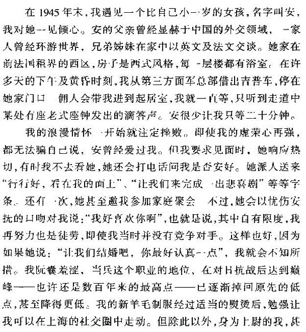

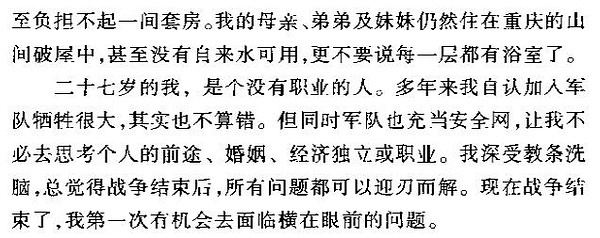

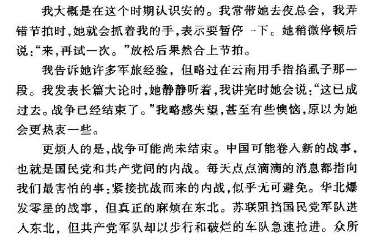

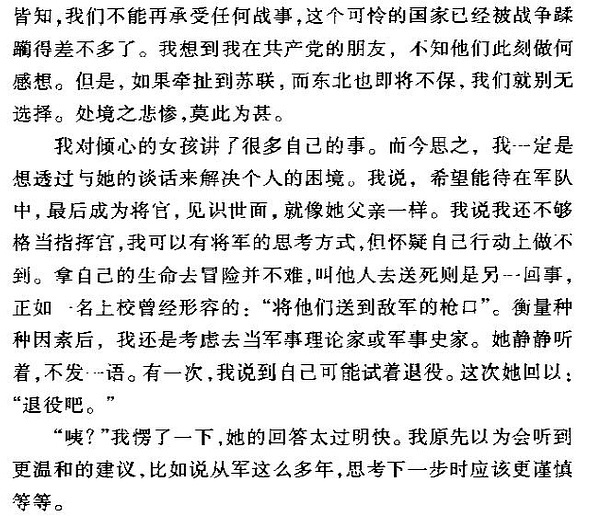

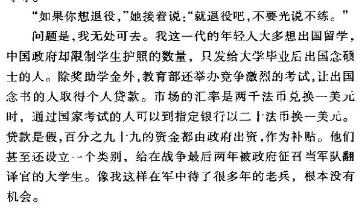

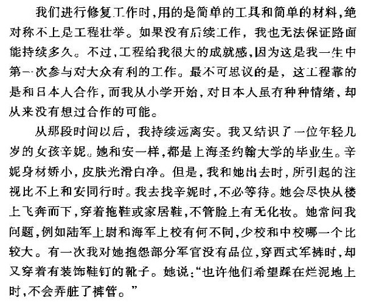

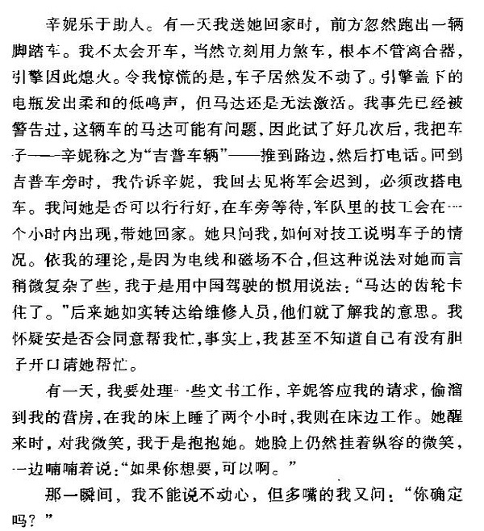

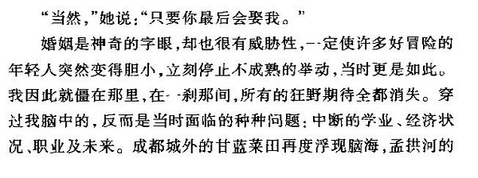

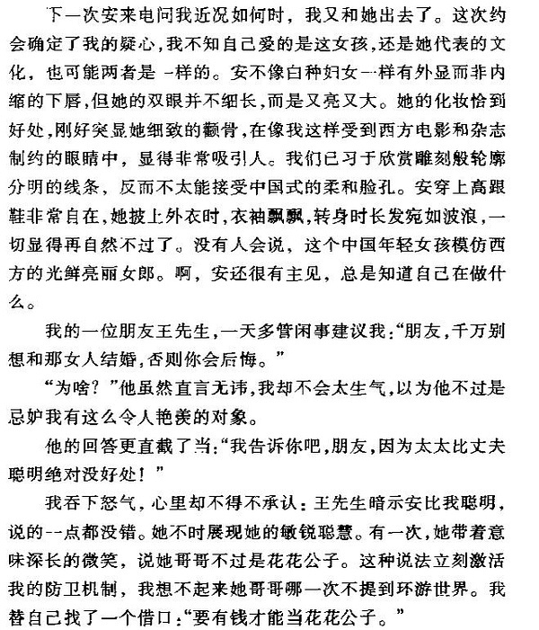

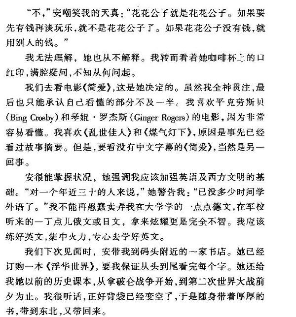

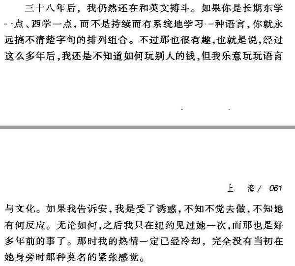

I include so much of the original text to show that Huang truly longed for this love back then, and that even in the twilight of his life he still could not forget it. So, back to the question: who was “An”? Her father was a diplomat who traveled the world in the early years of the Republic; there were several children; and in August 1945 they were living in Shanghai (one can guess they were also in the French Concession during the Japanese occupation, since Huang and his colleagues were the first group flown to Shanghai specifically to accept the surrender). By searching for well-known diplomats of the Republic of China, ministers to the United States, and ministers to Britain and France, I drew up a list of likely candidates, and then eliminated them by cross-checking the conditions.

For reference:

<https://zh.wikipedia.org/wiki/%E4%B8%AD%E5%9B%BD%E9%A9%BB%E7%BE%8E%E5%9B%BD%E5%A4%A7%E4%BD%BF%E5%88%97%E8%A1%A8#.C2.A0.E4.B8.AD.E8.8F.AF.E6.B0.91.E5.9C.8B.E9.A9.BB.E7.BE.8E.E5.9B.BD.E5.85.AC.E4.BD.BF.EF.BC.881912.E5.B9.B4-1935.E5.B9.B4.EF.BC.89>

III. Narrowing Down

The likely candidates include Quo Tai-chi (Guo Taiqi, 郭泰祺), C. T. Wang (Wang Zhengting, 王正廷), Wang Chonghui (王宠惠), David Z. T. Yui (Yu Rizhang, 余日章), Wang Dazhen (王大桢), W. W. Yen (Yan Huiqing, 颜惠庆), and V. K. Wellington Koo (Gu Weijun, 顾维钧). (Of course, it is entirely possible that An’s father is not among them; I can only say that much of what follows comes close to the An and the family that Mr. Huang described.)

After careful searching and cross-comparison, only two of them meet both conditions of having a residence in Shanghai and having several children of the right age: C. T. Wang, the father of the Chinese Olympics, and W. W. Yen, premier of the Beiyang government. Comparing their children, especially their daughters, narrows the range further, particularly on two points: marriage, and whether the residence was in the western district of the French Concession.

I looked into C. T. Wang first. This is his residence in Shanghai, No. 66, Lane 786, Julu Road; for photos and a description, see the link:

<http://shuzibao.jingan.gov.cn/html/2015-10/30/content_329095.htm>

Does Julu Road count as the western district of the French Concession?

The western district was newly expanded territory, mostly in what is now Xuhui District, west of Luwan District, so Julu Road can just barely count as part of the western district. For reference:

<https://zh.wikipedia.org/wiki/%E4%B8%8A%E6%B5%B7%E6%B3%95%E7%A7%9F%E7%95%8C#.E8.AE.BE.E7.AB.8B.E6.89.A9.E5.BC.A0>

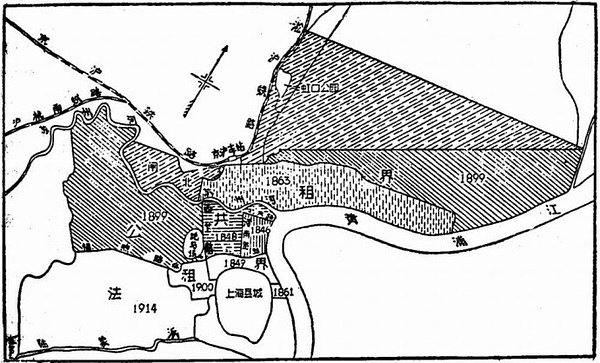

And his children all have the character 安 (An) in the middle of their three-character names: his eldest daughter Wang Anqing (王安庆), his second daughter Wang Anfu (王安福), and his third daughter Wang Anxiu (王安秀). So busybodies like me have thought in the past that “An” might be one of them. Unfortunately, a problem of timing in one news report seriously undermines this guess. It mentions something about the death of C. T. Wang’s youngest son:

<http://news.ifeng.com/gundong/detail_2012_04/12/13817212_0.shtml>

It says: “Qian Jialing is Wang Anxiu’s eldest son. In April 1942, Wang Gongwei, a class-A trainee at the Consulate General in Manila, was killed by the Japanese army; seven months later, Qian Jialing was born.” After all, in 1945 Huang was still anxious about whether to propose to An, yet by 1941 even the youngest of the Wang “An” daughters was already married, and the shy Huang was not so open-minded in such matters. Of course, there is no record of when the elder two married; but with the country shattered and children growing up fast, how could it be, by traditional thinking, that the youngest daughter already had a baby while four years later the eldest or second daughter was still waiting for the fruits of a free courtship?

So I turned to W. W. Yen. Below is his résumé, which is not hard to find online:

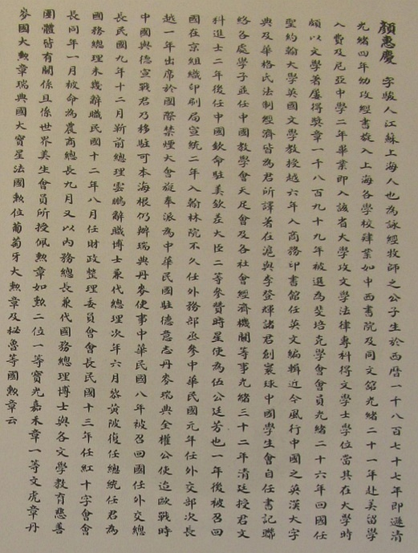

*https://www.thechinastory.org*

Here I should also mention the Chinese translation of his personal memoir (see 《颜惠庆自传》, the Chinese edition of *East-West Kaleidoscope, 1877–1946: An Autobiography*, or <https://zh.wikipedia.org/wiki/%E9%A2%9C%E6%83%A0%E5%BA%86#.E5.8F.82.E8.80.83.E6.96.87.E7.8C.AE>). I skimmed the whole thing; it ends in 1943, and the following two years can be filled in by comparing sources online. During his years as a diplomat in the 1930s and before, he truly traveled the world and saw a great deal.

In particular, some of the photos at the beginning and the content of the text are well worth comparing. An once mentioned that she had an elder brother who was a playboy; that cannot be known, but according to Yen’s own account, he did have two sons and several daughters.

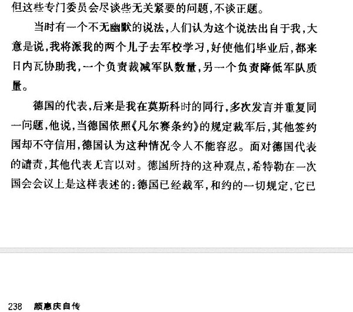

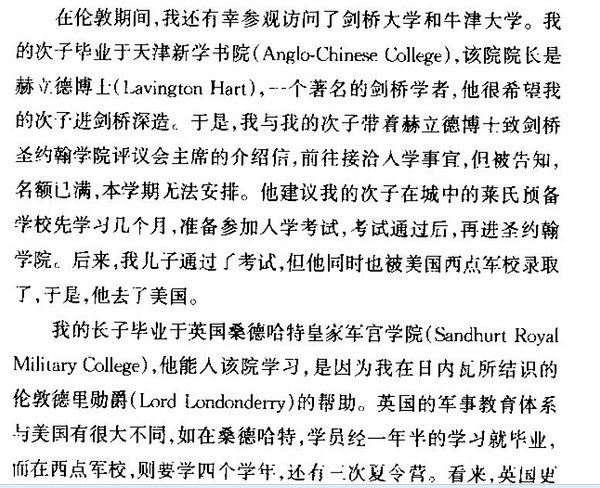

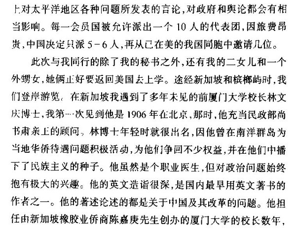

Moreover, as a diplomat of the Republic of China he often took his family with him on long postings abroad, and speaking at the Assembly of the League of Nations was a must. Here he mentions something about his choice of language:

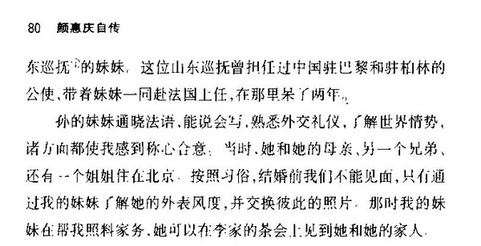

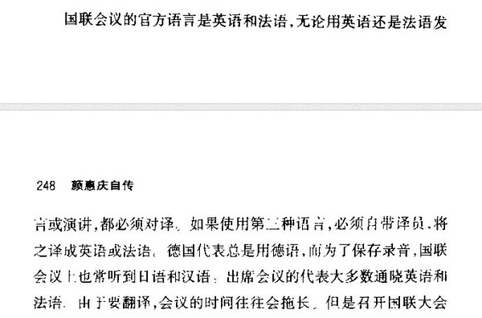

All of the above can more or less be taken as a reconstruction of Huang’s opening lines: “An’s father had once been prominent in China’s diplomatic circles; the family had traveled around the world, and the brothers and sisters spoke English and French at home.”

These somewhat far-fetched points alone are not enough; the daughters’ ages remain the more reliable evidence. The picture below, from his autobiography, is a photo of his three daughters together with a caption. This photo is very valuable for uncovering who “An” was.

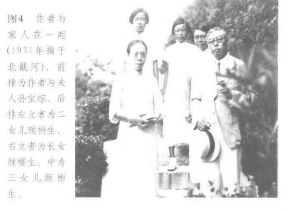

As for his three daughters, I found no records at all about the eldest, Yan Yingsheng (颜樱生), while a few scraps can be found about the second daughter, Yan Nansheng (颜枬生), and the third daughter, Yan Binsheng (颜彬生):

Of W. W. Yen’s daughters, the best known is Yan Binsheng, secretary to James Yen (Yan Yangchu, 晏阳初), who also died in 2002. She was born in Beijing in 1921 and attended the Tianjin Zhongxi Girls’ Middle School in her early years. In 1941 she went to study in the United States, entering the mathematics department at Cornell University. After graduating she went to work for General Electric. She later married Qin Baoxiong (秦宝雄), son of the famous modern Chinese mathematician Qin Fen (秦汾) and holder of a master’s degree in engineering from Purdue University.

<http://www.zijianfang.cn/html/y2011/27517.html>

<http://www.360doc.com/content/10/0916/08/2158376_54014069.shtml>

Very little can be found about the second daughter, Yan Nansheng: only the passage below and a list of names:

Should the glory of medicine also extend to the palliative care championed by Cicely Saunders? This reminds me that in the 1990s, Yan Nansheng, the second daughter of the diplomat W. W. Yen, had bone cancer and died in March 1992. In her last days, as her condition worsened, she said: “Now I only want to die, but I lack the courage. Maybe today, maybe tomorrow. Day after day passes, and I am still here.”

<https://book.douban.com/review/6580469/>

List of alumni of the University of Shanghai before 1945

<http://blog.sina.com.cn/s/blog_652847de0102dvef.html>

From this we know that both the eldest daughter, Yan Yingsheng, and the second daughter, Yan Nansheng, were born before 1921, which does not conflict with An’s age. But my personal, subjective feeling is that it is unlikely to be the eldest daughter, because in the photo she looks too much like her father (see the first on the left in the picture below), which is far from Huang’s description of An’s looks (see the screenshots at the beginning of this post). The second daughter, on the other hand, may simply not have grown into her looks yet, so there is still a sliver of hope.

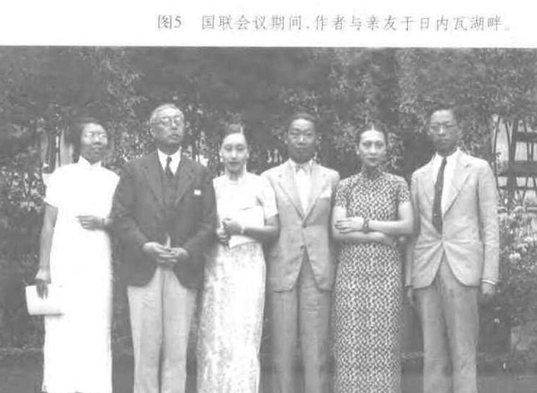

Huang mentions that An graduated from St. John’s College in Shanghai. Interestingly, W. W. Yen himself was one of the founders of this school and once taught there. But a piece of unfavorable evidence turned up: Yan Nansheng’s name appears on the University of Shanghai’s list of alumni from before 1945. Barring the accident of someone with the same name, since the University of Shanghai was also founded by a church, studying there would make sense; it is just hard to be sure whether she was ever at St. John’s.

Finally, on the address: W. W. Yen’s own residence was in Tianjin.

<http://www.zijianfang.cn/html/y2011/27517.html>

But according to his résumé: after the Pacific War broke out and Japan occupied Hong Kong, W. W. Yen was placed under house arrest, during which he refused Japan’s demand that he take a post in the pro-Japanese government; he was later arrested and taken back to Shanghai, where he was detained. After victory in the War of Resistance in 1945, Yen served in Shanghai as a member of the Shanghai Municipal Council and as chairman of the United Nations Relief and Rehabilitation Committee for the Far East, and was also elected a member of the first Legislative Yuan of the Republic of China. In addition, his younger brother F. C. Yen (Yan Fuqing, 颜福庆) had a house in Shanghai. According to one account: “In 1938, Yan Fuqing was transferred to Wuhan as director of the National Government’s Health Administration. He resigned the next year and returned to Shanghai.” Their time in Shanghai overlaps with when Huang met An.

Now look at the Yan family’s old house here. Source of the photo and description:

<http://blog.sina.com.cn/s/blog_51a238b40100q439.html>

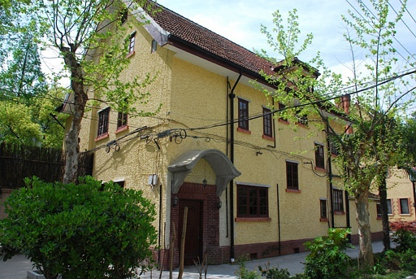

As shown above, F. C. Yen’s former residence is at No. 4, Lane 40, Wukang Road. Look at a map: this is right at the heart of the western district of the French Concession!

F. C. Yen’s former residence is an English country-villa-style garden house built in 1923, of brick and timber, with two full stories plus an attic floor. Its combined gable roof is very steep and covered with red machine-made flat tiles, with tall dormer windows on both the north and south sides. The exterior walls are pale yellow roughcast cement, the window frames are faced with red brick in a quoin pattern, and the east and west façades each have a large triple-flue chimney of exposed red brick. The two-story annex in the northwest houses a large kitchen, a garage, and so on. F. C. Yen lived here from 1943 to 1950. Perhaps his elder brother’s family also stayed here for a while after victory in the war in August 1945?

So could this be the home of An that Huang described?

IV. Conclusions and Questions

Her father’s career, her year of birth, the Western-style house, her brothers and sisters, the travels around the world, English and French: taken together, these factors make the idea that W. W. Yen’s second daughter, Yan Nansheng, was “An” seem somewhat convincing.

There are just two questions I still cannot answer but consider crucial. First, the second daughter, Yan Nansheng, was born before 1921, but where was she when she died of cancer in 1992? If she was An, she should have been in the United States, as Huang was. And W. W. Yen’s political leanings at the end of the civil war, and his death on the mainland in 1950, make one wonder whether his children stayed behind with him (at least the youngest daughter did not). If Yan Nansheng stayed on the mainland until 1992, then all the hypotheses above fall apart, because she could not have met Huang in New York. Second, there is the school: the University of Shanghai and St. John’s are hard to confuse, so if she was An, she must have attended both church schools, one after the other.

That is all for now on my subjective investigation of “An.” If I make new discoveries later, I will follow up here. Fellow busybodies are welcome to add to or correct this.

Finally, you might listen to this piece of music while reflecting on the whole series of things Huang went through.

<https://douban.fm/?start=2122458gce57g-3&cid=4122458&from_=weibo>

Special thanks to these sources of inspiration:

<http://www.xici.net/d59462484.htm>

<https://book.douban.com/review/1005411/>

<http://www.ruanyifeng.com/blog/2012/05/ray_huang_s_memoir.html>

Added the next day: according to new evidence, the speculation above probably does not hold, or at least the likelihood that Yan Nansheng was An must drop a great deal, and the investigation has to start over. According to the recollections of a childhood friend of hers, she went to the United States in the 1930s and never came back. The source of the evidence is below; see her work *Death and I* (《死亡与我》) and the translator’s note: “In 1938, when Ambassador Yen was again sent to the United States as ambassador, he took Nan with him to study there. After graduating from university she settled in New York and had two daughters and a son. In the late 1970s she came back several times to visit relatives and friends; she was found to have bone cancer and died in March 1992. Nansheng went abroad in 1938 to attend university in the United States, and it was not until the 1980s that she came back to Shanghai for Mrs. Yen’s funeral; after that she came back several more times, and each time we were able to meet briefly.”

Here is the link:

<http://www.lib-read.org/UserFiles/magazine/1340884851526.pdf>

In other words, there is no way to account for Yan Nansheng, who went to study in the United States in the 1930s, living in Shanghai at the time of the victory in 1945; and while her name appears on the University of Shanghai’s list of alumni from before 1945, no evidence was found of her studying at St. John’s. So the possibility that she was “An” is greatly weakened.

Afterword:

The investigation had originally ended there. Then, about four or five years ago, an internet user suddenly left me a message, as if they knew the answer key, and gave outright an answer that no one on the internet or in related research had ever stated directly. Although it cannot be confirmed 100 percent, the timeline fits. Here is that user’s reply: “Yan Nansheng had a cousin named Shu Li’an (舒丽安), with the character 安 (An) in her name. Shu Li’an (1917–2009) graduated from McTyeire School in Shanghai in 1937 and was taken by W. W. Yen to study at Elmira College in New York. After graduating in 1943 she did an internship at Johns Hopkins Hospital, and later married Cao Youcheng (曹友诚, 1915–2001), who held a PhD in metallurgy from the University of Michigan. *Dongcheng Xijiu: Seven Chinese Christian Families and a Century of Sino-Western Exchange* (《東成西就：七個華人基督教家族與中西交流百年》), pp. 101, 116.”

I tried doing a little follow-up research with family tree records, and it does seem to be so: in the late 1940s the couple lived in what is now DC, and they filled out a residents’ questionnaire showing that a child had been born. Their child attended high school in the 1960s and appeared in a group photo on the sports field lawn published in the school’s publication: a boy in black-rimmed glasses, very much the Asian stereotype. Later this child moved with his family to California and, around the 1970s, married a local white woman, and the couple, Shu Li’an and Cao Youcheng, were also buried in California. The boy is probably still alive today, while his children and grandchildren have melted into the torrent of history and vanished, no longer connected to the Eastern past recounted above.
