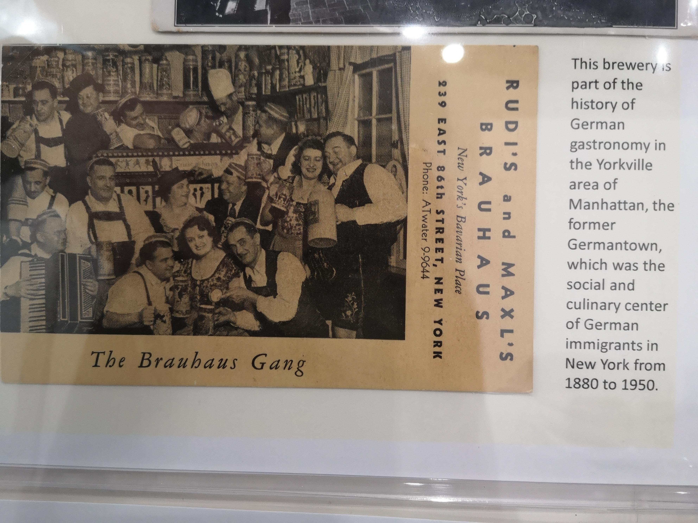

Lately I have often been thinking about one question: how did the accordion become more and more of a niche instrument? When I was in kindergarten and primary school, the accordion was probably the most popular non-traditional instrument. Many parents had their children practise at home during the week and then sent them to an accordion teacher’s home or a music class at the weekend. I remember there were about ten children in a class back then. Later, fewer and fewer children could be seen on the street carrying accordions, and after starting middle school I too set the accordion aside for the time being; in the blink of an eye, many years went by. My accordion teacher was born in 1948. During the civil war his family moved south to escape bandits, and later they settled in my hometown. He once said that his father was a traditional musician, but in the early 1970s he still chose the accordion, the most popular instrument at the time, as his main field of study.

The 1960s and 1970s seem to have been a great boom for the accordion. Starting around the mid-1950s, Italian accordion makers were eager to break into the huge emerging market of the United States. At the time they shipped their best products to America in large numbers, from full-size to compact models, all competing with one another for the market. Even now, if you look at the second-hand accordions on eBay, many of them were made in Italy in the late 1950s and early 1960s. I have heard people in different parts of the Northeast tell the same story: in the 1960s and 1970s, many children took lessons from a local accordion teacher, the classes could be large, and their first accordion was often an Italian instrument in a suitcase that their parents bought them at the time; then, once they started middle school, they stopped playing. My accordion has been repaired, directly or indirectly, by two people. The father of one of them, Paul Monte, was a well-known accordion teacher at that time, an Italian immigrant. He taught several members of my orchestra. If I had come ten years earlier, I might have heard him play live.

The accordion’s popularity, especially in the mid-to-late 19th century, came mainly with advances in instrument-making technology. The accordion had several advantages that were considerable for its time: it could play the tunes of different instruments at the same time, it was louder than the flute and some string instruments, and it was relatively easy to carry compared with the piano. Being a one-man band made it well suited to playing at all kinds of weddings and celebrations. This began in Europe, especially in Central and Southern Europe (in Southern Europe, lively accordion dance tunes were essential for group dancing at harvest time), and later, with immigrants, it appeared in transit hubs such as New York and in the westward expansion. But before the 1940s, the accordion in America was more an instrument carrying a label of cultural identity within the various European immigrant communities. For now I have no suitable way to work out whether the parents who chose to have their children learn the accordion in the 1960s and 1970s did so more out of some kind of cultural heritage after immigrating, or simply to follow a trend and not keep their children at home at the weekend. Still, I have always felt that the rise in the 1960s and 1970s and the decline today are different stages of the same group of people. This is the same as the situation in my hometown: most of the people still playing the accordion are from that generation of the 1960s and 1970s, while the number of players in the next generation has dropped sharply.

As for its flourishing on both sides of the Pacific, I have a rough guess that the two share a common origin. During the two world wars, large numbers of Central European (as well as Eastern and Southern European) migrants moved, by choice or by force, in two directions, east and west, and greatly influenced music teaching wherever they went. Those who went west eventually reached Western Europe and the Americas; those who went east influenced the music education system of Soviet Russia. In the United States, it was above all the immigrants who grew up around the Second World War who became the backbone of teaching and repair in the 1960s and 1970s. In the East, whether in the Balkans or the Far East, through the Cold War and Soviet influence, the accordion likewise became an important part of music education in the 1960s and 1970s. These preferences may have had something to do with leaders having been influenced by accordion music in the army when they were young. There is also a convincing view that the rise of the Beatles in the 1960s set off a craze for the guitar among young people that continues to this day. This also helped the guitar gradually replace the accordion as young people’s first choice of instrument for getting into music, making friends and chasing girls.

But this is also where the problem lies: once these new immigrants or political leaders of the 1960s and 1970s gradually left the stage of history, what force could keep the accordion as parents’ first choice of instrument for their children? Working backward from the present situation, I came up with a few reasons. First, most music schools in the United States today no longer offer an accordion major, even if they once did. This means there are not many teachers; today, if you want to learn the accordion, probably the most reliable way is online, studying for an hour or two at a time with a teacher in Europe across the time difference. Adults can of course teach themselves an instrument like this, but parents will probably have their children learn instruments whose supporting resources are well developed and easy to obtain. So this is probably a two-way process: fewer teachers lead to fewer new students (especially young students), and fewer young students lead to fewer teachers willing to devote themselves to the field (except in some European countries where the accordion is still fairly active). Compared with instruments such as the violin and the piano, which every year have large numbers of competitions, prize money, media exposure, orchestra positions and school posts, the accordion has been very clearly marginalized in the world of music since the start of the 21st century, or rather has become something like a novelty instrument or a vehicle for folk music.

Another thing that has to be mentioned is the gap in repairers. The accordion repairers I have met in Europe, the Americas and Asia almost all no longer treat repair as a career (even if it once was), but as a sideline or a last interest before retirement. For one thing, orders are very unstable; for another, the supply of materials is not guaranteed, and they have to keep buying second-hand instruments and taking out usable parts to make up for it. Many glues and finishing materials have to be mixed by the repairers themselves rather than bought on the market (I suspect part of the reason is that the wood of these 50- to 100-year-old instruments is more easily damaged by certain chemicals), and once they retire or die, no one else knows how. I once heard a repairer in Franklin, Tony, say with great regret that after one of his predecessors died, no one knew what had become of the whole warehouse of materials he once had; to outsiders, these things are probably worth nothing at all. And a repairer in Scotland, Alex, closed his studio during the pandemic (it had offered repairs and teaching for many years) and now only organizes performances with his small orchestra in his spare time. He also admitted that as he gets older, the effort that goes into repairs is out of proportion to the income. I remember a large black-and-white photo in his house of many little children (perhaps only six or seven years old) holding accordions. Another interesting thing is that these repairers with no one to carry on their work all keep dogs, and once they start playing, the dog curls up at their feet with its eyes closed, listening quietly.

Having lost the support of a systematic teaching system and good after-sales service, the accordion is now on the edge of a break. The problem is not the present, and besides, I still see many excellent players, quite a few of them young; it is mainly the lack of fresh blood. The electronic accordion may be one way forward, but I still feel that the whole supporting environment around its users is not enough to encourage product iteration and new investment. It takes an active community giving feedback and sustained buying power to support continuous innovation until a revolutionary product is developed. Roland has already stopped producing, or stopped servicing, many of its models. The models still supported have to be sent to California, and more often the only option is repair by enthusiasts on their own.

At a stamp show this summer, I came across this photo, taken in a Central European immigrant community in Manhattan. Even though these people are no longer here today, and perhaps neither is the accordion, I can still feel through the photo the joy they had when they played.

