一.引子

近日因偶然发现钱穆的作品，引申出了与黄仁宇（1918-2000）的历史观对比，以至延伸其个人回忆录《黄河青山》与历史小说《汴京残梦》，黄老的《万历十五年》已是其晚年作品，之前大半世纪沉浮可谓可歌可泣。其中某些内容黄老闪烁其词，欲言又止，且在回忆中补充了些许证据，更有《汴京残梦》中含沙射影的意味，无奈八卦念起，不禁想考据一下这本黄老嘱托逝世后才准发表的个人回忆录里开篇的那个名为“安”的女子是谁。

因资料不多，一时兴起且带有一定先入为主观念，考据中多推测，少结论，还望见谅。

先总结一下原文中一些关于“安”的信息，除了这个称呼，其他应当基本属实：

安，女性，生于1918-1920年之间（考虑到虚岁或观念之类，姑且放大一点范围），家住上海法租界西区多层洋楼，上海圣约翰大学毕业，生性聪慧，言行与意识均处于时代女性先列，熟悉英法语言，家父为民国时期外交家，有兄弟姊妹，过去曾举家环游世界，26岁左右于上海认识黄某，五十年代之后曾与黄某于纽约再遇，应已移居美国。

二.原文

下面把原文与“安”有关的内容列出，基本都是1945年8月黄某前往上海接受日军投降后发生的事情，持续至当年年底。

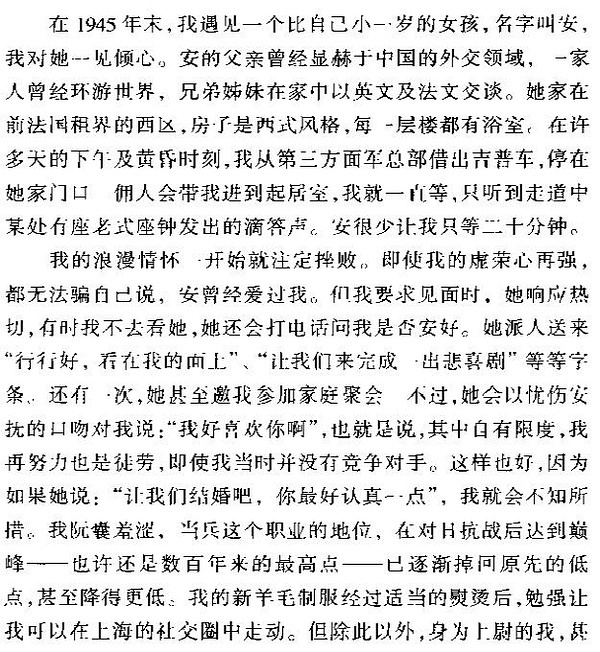

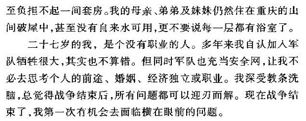

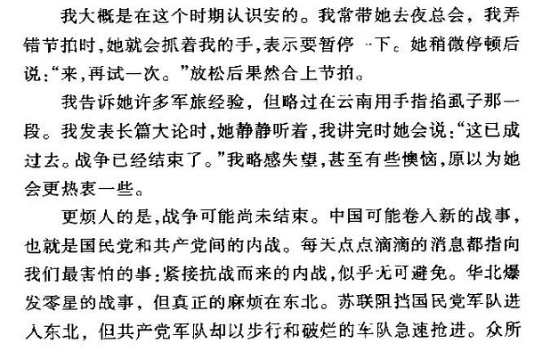

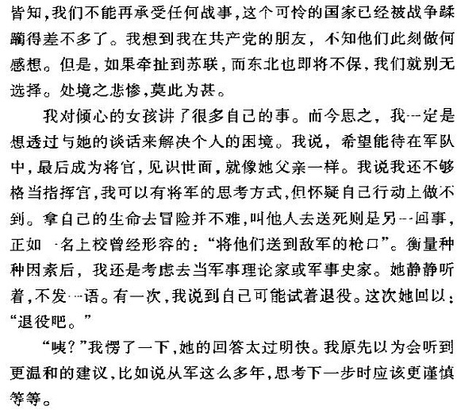

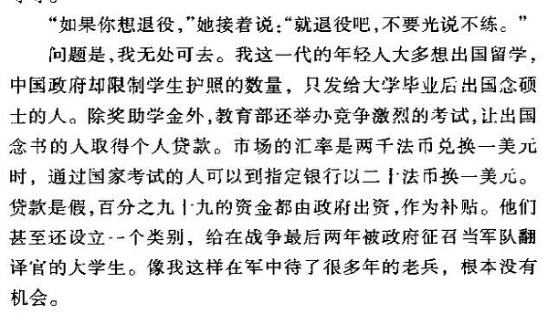

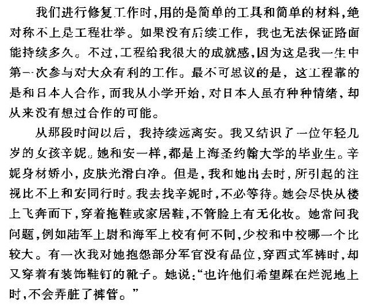

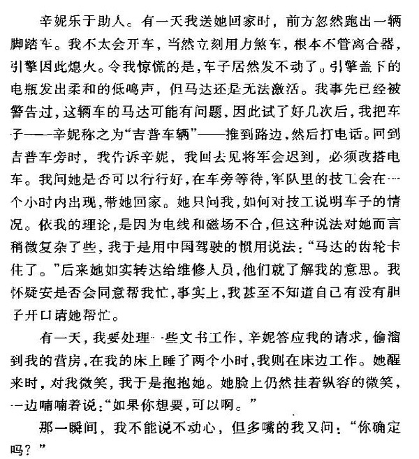

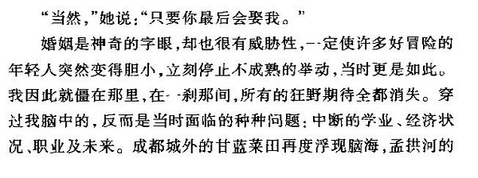

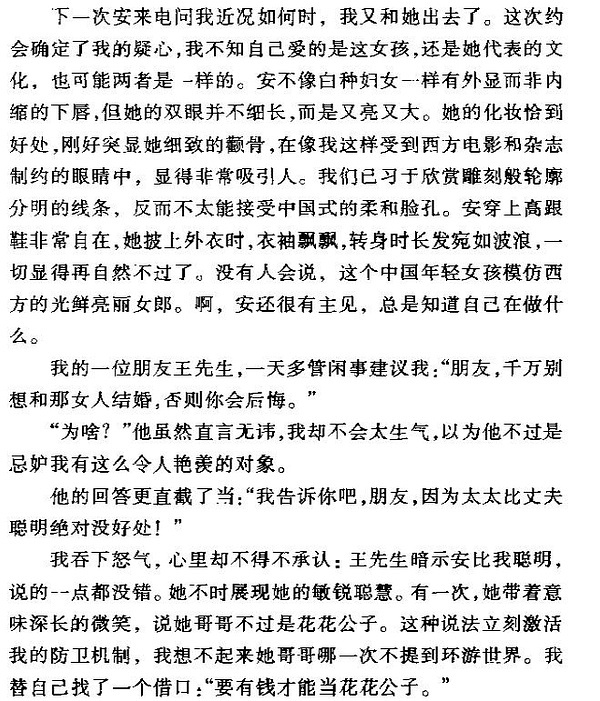

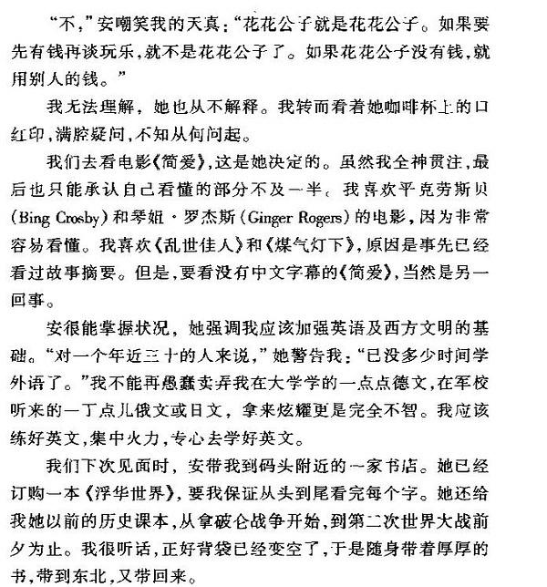

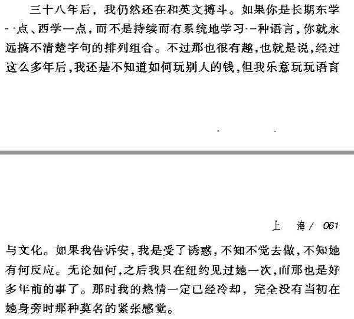

加入这么多原文，意在说明黄老当年应是真心渴望这份爱情，哪怕后来已是风烛残年的岁数，依然念念不忘。那么回到问题上来，“安”是谁？父亲是民国早年踏足世界的外交家、多位子女，45年8月在上海居住（可以推测日占期间也在法租界，毕竟黄老他们是第一批飞沪专门来受降的），通过搜寻民国知名外交家，驻美公使和驻英法公使，我列出了一些热门人选，之后再通过条件交叉进行剔除。

参考例：

<https://zh.wikipedia.org/wiki/%E4%B8%AD%E5%9B%BD%E9%A9%BB%E7%BE%8E%E5%9B%BD%E5%A4%A7%E4%BD%BF%E5%88%97%E8%A1%A8#.C2.A0.E4.B8.AD.E8.8F.AF.E6.B0.91.E5.9C.8B.E9.A9.BB.E7.BE.8E.E5.9B.BD.E5.85.AC.E4.BD.BF.EF.BC.881912.E5.B9.B4-1935.E5.B9.B4.EF.BC.89>

三.筛选

热门人选包括：郭泰祺、王正廷、王宠惠、余日章、王大桢、颜惠庆、顾维钧（当然，安的父亲也完全有可能不在其中，只能说下面的内容中有不少贴近于黄老先生所描述的安及她的家庭）

通过注意检索和交叉对比，其中因上海有宅邸和拥有多位符合年龄子女两个条件皆符合的仅有两人，即中国奥运之父的王正廷，及北洋军阀政府总理颜惠庆。通过对比其子女，尤其是女儿的条件可以进一步缩小范围，尤其是婚嫁和居所是否属于法租界西区这两点。

我先查阅的是王正廷，这是他在上海的居所，巨鹿路786弄66号，图片与介绍见链接：

<http://shuzibao.jingan.gov.cn/html/2015-10/30/content_329095.htm>

巨鹿路算不算法租界的西区？

西区，新扩张地，多在徐汇区，较之卢湾区为西，因而巨鹿路可勉强算作西区，参考如下：

<https://zh.wikipedia.org/wiki/%E4%B8%8A%E6%B5%B7%E6%B3%95%E7%A7%9F%E7%95%8C#.E8.AE.BE.E7.AB.8B.E6.89.A9.E5.BC.A0>

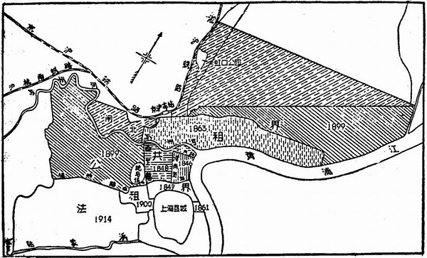

而他的几个子女，三个字中间皆有“安”字，即长女:王安庆,次女:王安福,三女:王安秀。因而过去也曾有如我等好事者觉得，有可能“安”便是在其中之一。可惜一篇报道的时间问题很严重地挫败了这种推测，这里提及了王正廷小儿子牺牲的一点事情

<http://news.ifeng.com/gundong/detail_2012_04/12/13817212_0.shtml>

其中提及“钱嘉陵是王安秀的大儿子，1942年4月，任马尼拉总领事馆甲种学习员的王恭玮被日军杀害，7个月后钱嘉陵出生。”毕竟到了1945年黄老还在紧张于是否应该向安提出婚嫁，但1941年王氏最小的“安”小姐都已经出嫁了，害羞的黄老这方面观念还不至于如此开放。当然，前面两位何时结婚尚无资料可查，只是国破山河在，儿女早当家，传统观念里岂有小女儿已经生娃，四年之后大女儿或二女儿还在等待自由恋爱的成果之理？

目标转向颜惠庆。下面是他的个人简历，这个在网上不难找

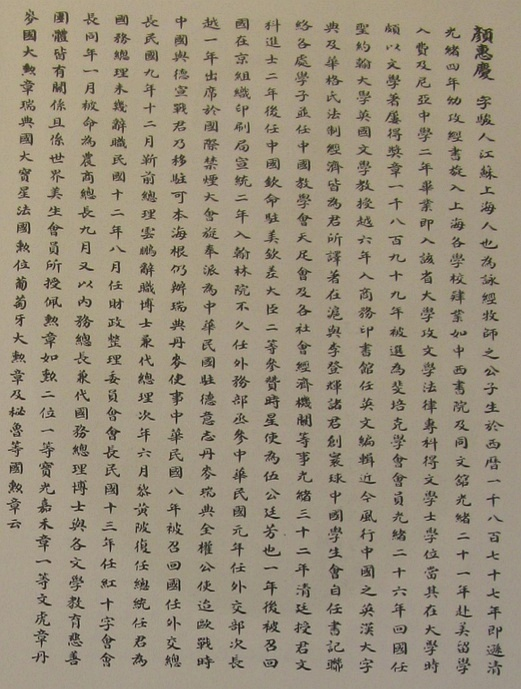

*https://www.thechinastory.org*

这里，再补充一下其个人日记回忆录的汉译本（见《颜惠庆自传》或<https://zh.wikipedia.org/wiki/%E9%A2%9C%E6%83%A0%E5%BA%86#.E5.8F.82.E8.80.83.E6.96.87.E7.8C.AE>），草草浏览了一下全文，全文止于1943年，后面两年的内容可在网上借助对比进行补全，他在三十年代及之前担任外交官期间，真的可谓是环球世界，见识颇多。

尤其在开头的一些照片和文中的内容，对比很有意义，安曾提及她有个哥哥，是花花公子，这一点不得而知，但根据颜惠庆自述，他确实有两个儿子，和多位女儿。

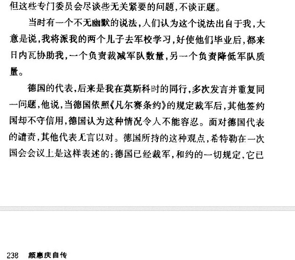

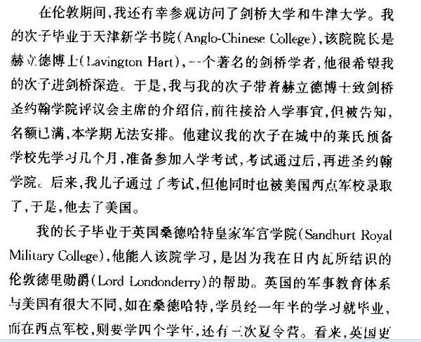

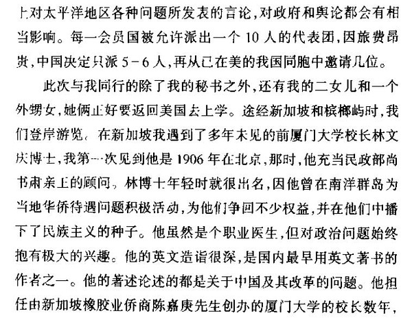

而且因为担任民国外交官，每每携带家属常驻他国，在国际联盟大会上发言是必须的，这里他提及了一点语言选择上的内容：

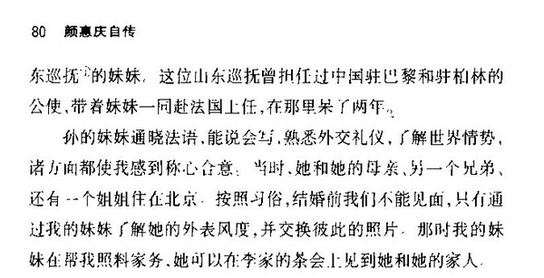

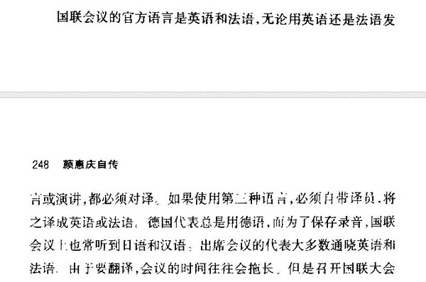

上述这些基本可算作是黄老开场原文“安的父亲曾经显赫于中国的外交领域，一家人曾经环游世界，兄弟姊妹在家中以英文及法文交谈”的还原。

仅仅上面这些有些牵强附会的内容是不够的，女儿的年龄依然是比较可靠的依据。下图是来自他自传中的三位女儿的合影及介绍，这一照片对于挖掘“安”的人物，十分有价值。

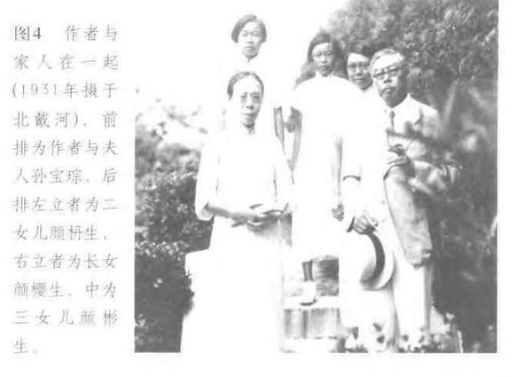

关于他的三位女儿，大女儿颜樱生的信息并未找到任何相关记载，另外二女儿颜枬生和三女儿颜彬生可以寻得一点只言片语：

颜惠庆的女儿，最为知名的是晏阳初的秘书颜彬生，也于2002年去世。她1921年出生于北京，早年就读于天津中西女子中学。1941年赴美留学，入康奈尔大学数学系。毕业后进入美国通用电器公司工作。后与中国近代著名数学家秦汾先生之子、普渡大学工程学硕士秦宝雄先生结婚。

<http://www.zijianfang.cn/html/y2011/27517.html>

<http://www.360doc.com/content/10/0916/08/2158376_54014069.shtml>

二女儿颜枬生查询到的资料很少，仅有下文及一份名单而已：

医学的荣光是否也应该覆盖到塞西莉•桑德斯倡导的姑息疗法，这让我想起，上世纪90年代，外交家颜惠庆的次女颜枬生患骨癌，1992年3月逝世，最后的时间里，病情恶化了，她说：“现在我只想死去，却缺乏勇气，也许是今天，也许是明天。过了一天又一天，而我还呆在这里。”

<https://book.douban.com/review/6580469/>

沪江大学1945年之前校友名单

<http://blog.sina.com.cn/s/blog_652847de0102dvef.html>

由此可知，大女儿颜樱生与二女儿颜枬生都是出生于1921年之前，这一点与安的年龄，并不冲突。但我个人主观上觉得不太可能是大女儿，因为照片上她和父亲太像了（见下图左一），而与黄老的相貌描述（见本文开头截图），相距甚远。倒是二女儿可能还未长开而仍有一丝期待。

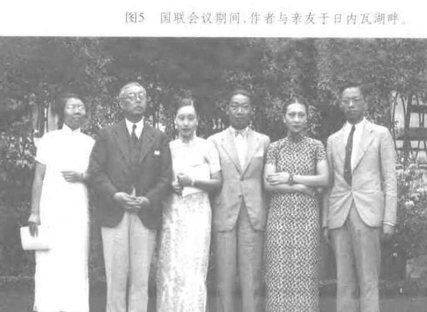

黄老提及，安毕业于上海圣约翰学院，有意思的是颜惠庆本人便是这所学校的创始人之一，并曾经在那里教书。但一个不是有利的证据出现了，颜枬生的名字出现在了1945年之前沪江大学的校友名单上，除了有重名这种意外之外，鉴于沪江大学也是教会创办学校，去那里上学这倒也说得通，只是难以确定她是否有在圣约翰学院了。

最后，关于住址，颜惠庆本人的住宅是在天津的

<http://www.zijianfang.cn/html/y2011/27517.html>

但根据他的履历：太平洋战争爆发后，日本占领香港，颜惠庆被软禁，其间拒绝了日方要其出任亲日政府职务的要求，后被逮捕押回上海关押。1945年抗战胜利后，颜惠庆在上海任上海市参议员、联合国远东救济与复兴委员会主席，还当选为第1届中华民国立法委员。另外，他的弟弟颜福庆在上海是有住宅的，根据描述：“1938年，顏福慶被調至武漢，任國民政府衛生署署長。次年辭職回到上海。”他们在上海的时间是重叠于黄老遇到安的时间。

再看颜家在这里的老宅：图片和老宅描述来源

<http://blog.sina.com.cn/s/blog_51a238b40100q439.html>

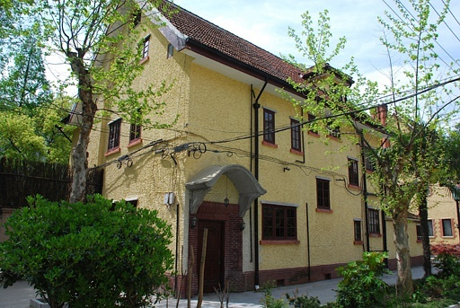

如上图所示，颜福庆故居座落于武康路40弄4号，看地图去，这里正是法租界西区的核心区域！

颜福庆故居系英国乡村别墅式花园住宅，建于1923年，砖木结构假三层，组合式人字坡顶十分陡峭，屋面覆盖红色机平瓦，南北皆设置高耸的老虎窗。建筑外墙为淡黄色水泥拉毛，窗边框以隅石形红砖贴面装饰，东西外立面各建有一个三联式的清水红砖大烟囱。西北部二层辅楼设置有大厨房和车库等。1943～1950年间，颜福庆曾在此居住。或许兄长一家45年8月抗战胜利后也在此暂住？

所以，这里是不是可能就是黄老口中安的家呢？

四.结论及疑问

家父履历、出生年龄、西式住宅、兄弟姐妹、周游列国、英语法语，这些因素汇聚起来，颜惠庆的二女儿颜枬生是“安”这件事情似乎还是有些说服力。

只是有两点疑问我仍然无法知道却又觉得十分关键：首先，最后二女儿颜枬生于1921年之前但在1992年死于癌症的时候身在何处呢？如果她就是安，应该和黄老一样都在美国。而颜惠庆在内战末期的政治倾向和1950年在大陆的逝世，都让人怀疑，他的子女是否有留下陪他（至少小女儿没有），如果颜枬生一直留在大陆直到1992年，那么上述所有假设便都不成立，因为她不可能与老黄在纽约相遇。其次，便是学校，沪江与圣约翰是很难混淆的，倘若她是安，那么得先后去过两所教会学校。

关于“安”的主观考据暂时到此，如果有我日后又有新的发现或，这里应该会有跟进。同为好事者，欢迎补充指正。

最后，你可以借着这首曲子，细细回想一下黄老经历的那一系列事情。

<https://douban.fm/?start=2122458gce57g-3&cid=4122458&from_=weibo>

特别感谢这些灵感来源：

<http://www.xici.net/d59462484.htm>

<https://book.douban.com/review/1005411/>

<http://www.ruanyifeng.com/blog/2012/05/ray_huang_s_memoir.html>

隔日补充：根据新的证据，前文推测恐不成立，或至少颜枬生是安的可能恐怕要下降许多，考据需推倒重来：据其小时候好友回忆，她三十年代便前往美国，之后未曾归来。证据来源如下，见其著作《死亡与我》及译者注：“1938 年在颜大使再次奉派赴美任大使时携枬赴美留学，大学毕业后在纽约成家育二女一男，七十年代末回国探亲友数次，查出患骨癌，1992年3月逝世。枬生是1938年出国赴美读大学的，直到八十年代她才归国上海奔丧颜太夫人逝世以后她又回国几次，我们每次都能短聚一下。”

这是链接：

<http://www.lib-read.org/UserFiles/magazine/1340884851526.pdf>

换言之，因为无法给出三十年代即前往美国读书的颜枬生在1945年胜利生活于上海的可能性，而她的名字同时又出现在沪江大学1945年之前的校友名单上却没有找到在圣约翰大学的读书证据。所以“安”的可能性被极大削弱。

后记：

本来调查到此就结束了，大约四五年前，忽然有一位网友给我留言，仿佛是知道参考答案一般。直接给出了这个目前互联网和相关研究中从未有人正面给出的答案，虽然无法100%确认，但是时间线是吻合的。以下是这位网友的回复“颜枬生有个表妹叫“舒丽安”，带个安字。 舒丽安，（1917-2009），1937年毕业于上海中西女中，由颜惠庆带到纽约Elmira学院进修，1943年毕业后到霍普金斯大学医院实习，后嫁曹友诚（1915-2001），密歇根大学冶金博士。《東成西就: 七個華人基督教家族與中西交流百年》P101，116.”

我尝试用family tree进行了一点后续调查，大概确实如此：这对夫妻在四十年代后期居住在现在的DC，并且填写了一份居民调查问卷显示孩子已经出生。他们的孩子在六十年代的时候上中学，在球场草坪上合影刊登在学校校刊上，是非常亚裔刻板印象的一个戴着黑框眼镜的男孩子。后来这个孩子举家迁往加州，大约在七十年代和当地的一位白人女性结婚，而这对夫妻，也就是舒丽安和曹友诚也葬在了加州。这位男孩子目前大概依然健在，而其下一代，下下代已经融入历史的洪流中消失不见，与我们前面叙述的东方往事不再关联。
