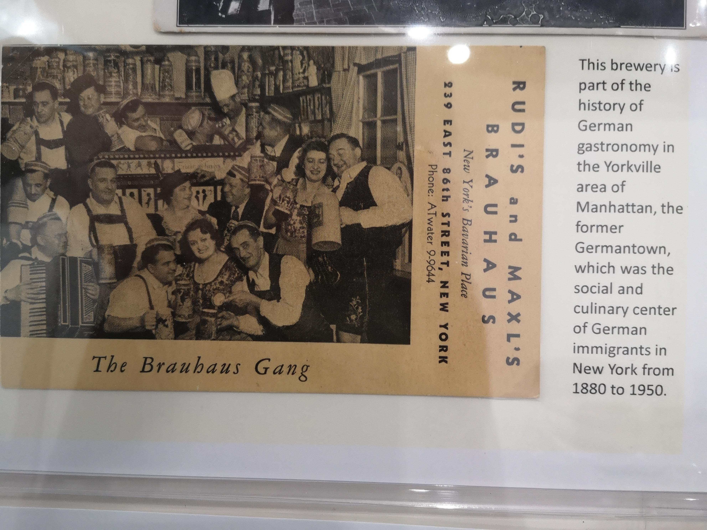

最近我经常想一个问题，手风琴是怎么变得越来越小众的。在我还在幼儿园和小学时候，手风琴大概是最受欢迎的非传统乐器，很多父母会让自己的孩子平时在家练习然后周末送到手风琴老师家或者音乐兴趣班。我记得当时一个班有差不多十个小孩。后来路上背着手风琴的孩子越来越少，我也因为上中学后就暂时搁置了手风琴，转眼许多年过去了。我的手风琴老师是1948年出生的，当时他家在内战时期南下躲避土匪，后来就在我老家安家了。他曾经说过他父亲是个传统音乐家，但是在70年代初他还是选择了当时最受欢迎的手风琴作为他的主修方向。

六七十年代似乎是手风琴的一个大流行时期。大约在五十年代中期开始，意大利的琴商们就很想打开美国这个巨大的新兴市场。当时他们把最好的产品大量运往美国，从全尺寸到紧凑型，这些产品互相竞争抢占市场。现在你在ebay上看那些二手手风琴，依然很多是50年代末到60年代初产自意大利的。我曾听东北部不同地区的人讲述一个相同的故事，那就是在六七十年代的时候，很多孩子会找当地的手风琴老师学习，课堂可能会很大，而他们的第一台手风琴经常便是那个时期父母为其购买的装在手提箱中的意大利产品，然后他们在进入中学后便不再弹奏手风琴。我的手风琴曾经被两个人直接或者间接维修过，其中一个人的父亲Paul Monte在当时便是一个有名的手风琴老师，一位意大利移民。他曾经是我乐团的几位成员的老师。如果我早来十年，大概能听到他现场演奏。

手风琴的流行，尤其是在19世纪中后期主要是伴随乐器加工技术的进步。手风琴有一些在当时看很大的优势，包括可以同时演奏不同乐器的曲调以及相对于笛子和一些弦乐器有着更大的声音，以及和钢琴比相对轻便的携带方式。一个人的乐队（one man band）使之很适合成为各种婚庆现场的演奏乐器。这一点首先是从欧洲开始，尤其中欧和南欧（南欧的丰收季节手风琴的欢快舞曲是集体舞蹈必备的），后来随着移民在纽约这样的中转站和西进运动中出现。但在二十世纪四十年代之前，手风琴在美国更像是欧洲各个移民团体内部的带有文化认同标签的乐器。我暂时没有适当的方法能够统计出那些60，70年代选择让孩子学习手风琴的父母更多是出自某种移民后的文化传承还是仅仅在跟随潮流不想让孩子周末待在家里。不过我一直觉得六七十年代的兴起和如今的衰落是同一批人的不同阶段。这一点和我的家乡情况是相同的。那就是还在弹手风琴的人基数占到多数的仍然是六七十年代的那一批人群，但是后来出现的下一代演奏者数量便大幅度减少了。

对于其在太平洋两岸的兴盛，我有一个同源的粗糙猜想。那就是在两次世界大战期间的中欧（以及东欧南欧）移民大量主动或者被动向东西两个方向迁徙，并且大幅影响了其迁徙地的音乐教学。向西的一支最终抵达西欧和美洲，向东的一支则影响了苏俄的音乐教学体系。对于美国来说，尤其是第二次世界大战前后成长起来的那一批移民，他们成为了六七十年代教学和维修的中坚力量。而在东方，无论是巴尔干还是远东，通过冷战和苏联的影响力，手风琴同样在六七十年代的音乐教学体系中成为了重要的角色。这些偏好可能和领导人年轻时期在军队中受到手风琴音乐的影响有一定关系。还有一种令人信服的观点，那就是Beatles在60年代的崛起，带动了年轻人转向吉他的热潮，这股热潮持续至今。这也促进了吉他逐渐取代了手风琴成为年轻人接触音乐，交友把妹的首选乐器。

但问题同样出在这里，一旦六七十年代的这批新移民或政治领袖逐渐退出了历史舞台，还有什么力量能继续推动手风琴继续成为父母给孩子首选的乐器？我从现状反推了一些原因。首先是如今美国的多数音乐学校已经不再有手风琴专业这个方向，哪怕曾经有过。这也就使得没有那么多老师存在，今天如果你想学习手风琴，大概比较可靠的方法就是通过互联网在线和一位来自欧洲的老师跨越时差每次学习一两个小时。固然这类乐器对于成年人来说可以自学，但是对于父母来说，大概会让小孩去学习那些配套资源完善而且容易获取的乐器。所以这大概也是双向选择，越少的老师导致越少的新学生（尤其年轻学生），越少的年轻学生导致越少的老师愿意投身相关事业（除了在一些手风琴依然较为活跃的欧洲国家）。比起小提琴钢琴这类每年有大量比赛，奖金，媒体曝光度，乐团位置，学校岗位的乐器。手风琴在21世纪以来在音乐世界的边缘化非常明显，或者说变成了某种类似特色乐器或者民族音乐演奏的载体。

还有一点不得不提的是，维修者的断档。我在欧洲，美洲，亚洲遇到的不同手风琴维修者几乎都不再将之视为事业（哪怕曾经是的），而是某种兼职或者退休前最后的一些兴趣。一方面订单很不稳定，第二方面原材料供应也没有保障，他们需要不断收购二手琴并且从中拆出有用的部件作为补充。而很多胶水和涂装材料需要靠维修者自己调配而不能从市场上直接购买（我猜测一部分原因是这些50年到100年的琴的木材更容易被一些化学成分所腐蚀），一旦他们退休或者去世便无人得知。我曾听一位在Franklin的维修者Tony无比惋惜的说自己的一位前辈在去世后没有人知道他原本一大仓库的原材料去了哪里，对于外行这些大概根本不值一文。而在苏格兰的一位维修者Alex在疫情期间关闭了他的studio（同时有着多年维修和教学服务）后，只在业余时间组织他的小规模乐团表演。他也坦言，随着年龄的增长，维修所投入的精力和收入回报不成比例。我记得他的屋里有一幅很大的黑白照片，里面是许多拿着手风琴的小孩子（可能只有六七岁）的合影。还有个有意思的事情是，这几位后继无人的维修者都会养狗，一旦他们开始演奏，狗便会闭着眼睛蜷缩在他们脚旁，安静地聆听。

失去系统教学体系的支持以及完善售后服务的手风琴现在处于一种断档边缘的状态，问题并不在于现在如何，况且现在我依然看到很多优秀的演奏者，其中也不乏年轻人，主要在于缺少新鲜血液的注入。电子手风琴可能是一条出路，但我依然觉得是使用者所处的整个配套环境不足以激励产品的迭代和更新投入。要有活跃的社区反馈和持续的购买能力才能支持其不断创新直到研发出具有革命性的产品。Roland目前很多型号已经停止生产或者停止售后维修。而那些依然支持的型号则需要寄到加州，更多只能靠民间自发维修。

我在今年夏天的邮票展览上无意看到了这张记录在曼哈顿中欧移民社区的照片，哪怕这些人如今都已经不存在了，可能还包括那个琴，我依然能透过照片感受到他们现场演奏时的快乐。

