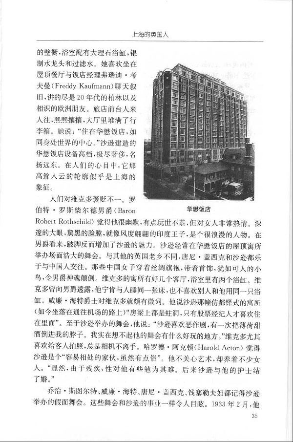
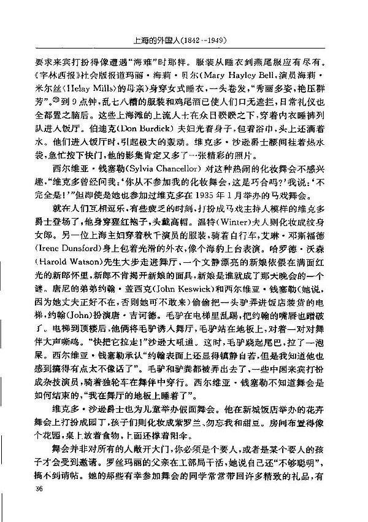
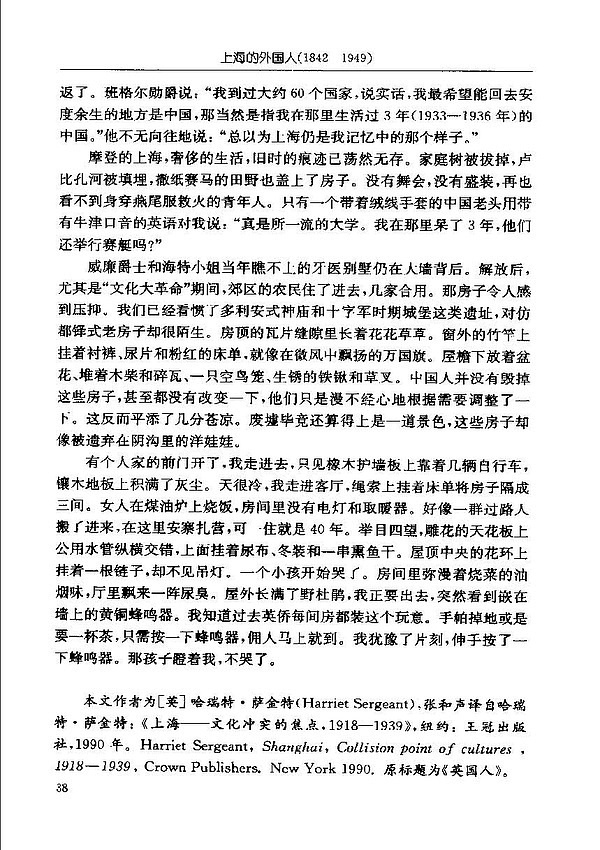

> The front door of one house was open, and I went in. Several bicycles leaned against the oak wainscoting, and the parquet floor was thick with dust. It was cold. I went into the drawing room, where sheets hung on ropes divided the house into three rooms. A woman was cooking on a kerosene stove; there was no electric light and no heater. It was as if a group of passersby had moved in and pitched camp here, and then stayed for forty years. Looking around, I saw communal water pipes crisscrossing the carved ceiling, hung with diapers, winter clothes, and a string of smoked dried fish. A chain hung from the garland in the middle of the ceiling, but there was no chandelier. A child began to cry. The room was thick with the smell of cooking oil, and a whiff of urine drifted in from the hall. Wild azaleas grew all over outside. I was about to leave when I noticed a brass buzzer set into the wall. I knew that in the old days the British residents had one of these in every room. A dropped handkerchief, or a cup of tea: one press of the buzzer, and a servant would come at once. I hesitated for a moment, then reached out and pressed it. The child stared at me and stopped crying.
> 
> — Quoted from “The British in Shanghai”

For the original text, see Harriet Sergeant, *Shanghai: Collision Point of Cultures, 1918–1939* (New York: Crown Publishers, 1990), chapter “The British.”

