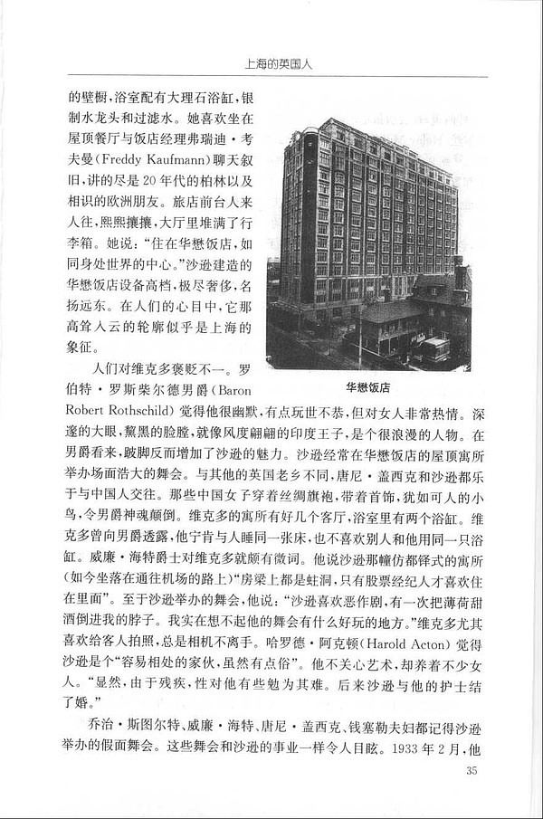
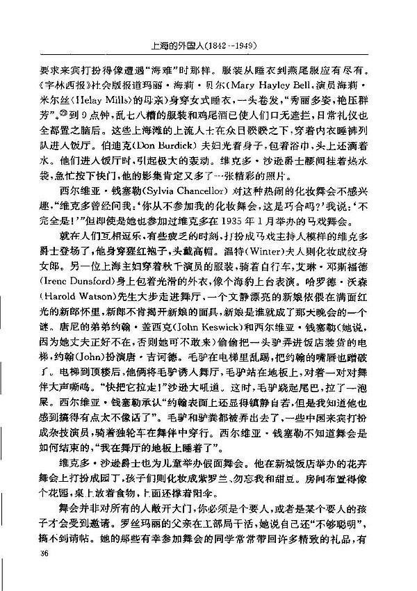
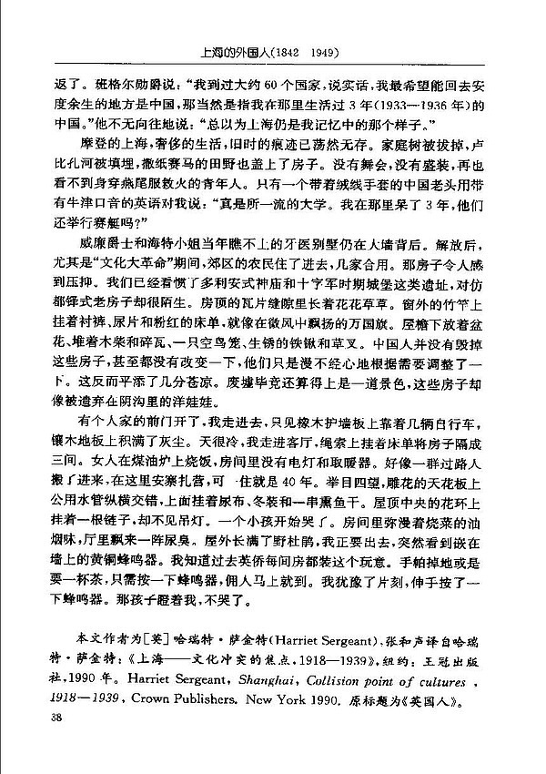

> 有个人家的前门开了，我走进去，只见橡木护墙板上靠着几辆自行车，镶木地板上积满灰尘。天很冷，我走进客厅，绳索上挂着床单将房子阁成三间。女人在煤油炉上烧饭，房间里没有电灯和取暖器。好像一群过路人搬了进来，在这里安营扎寨，可一住就是40年。举目四望，雕花的天花板上公用水管纵横交错，上面挂着尿布，冬装和一串熏鱼干。屋顶中央的花环上挂着一根链子，却不见吊灯。一个孩子开始哭了。房间里弥漫着烧菜的油烟味，厅里飘来一阵尿臭。屋外长满了野杜鹃，我正要出去，突然看到嵌在墙上的黄铜蜂鸣器。我知道过去英侨每间房都装这个玩意。手帕掉地或是一杯茶，只需按一下蜂鸣器，佣人马上就到。我犹豫了片刻，伸手按了一下蜂鸣器。那孩子瞪着我，不哭了。
>
> —— 引自 上海的英国人

