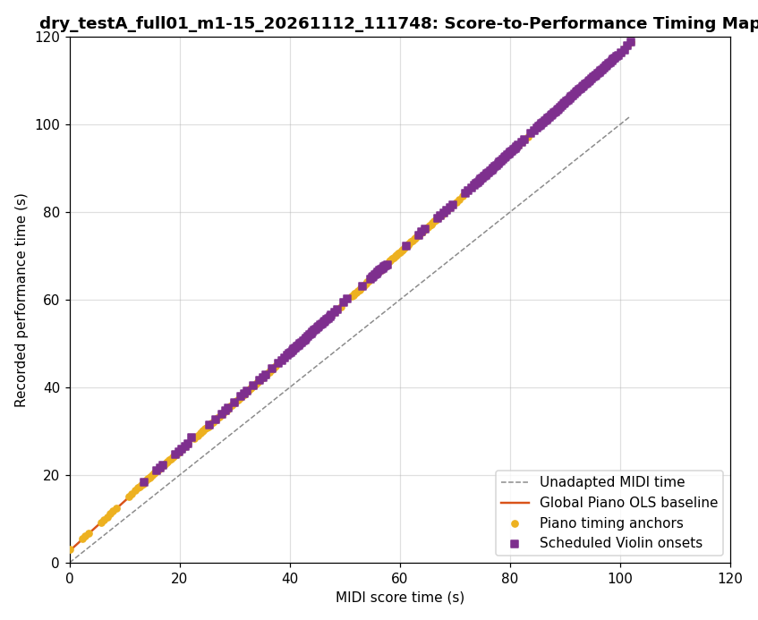
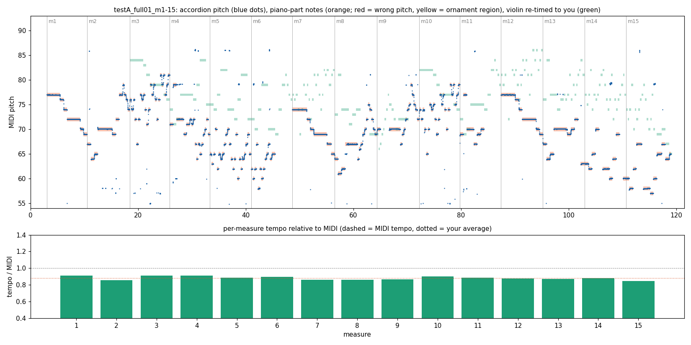
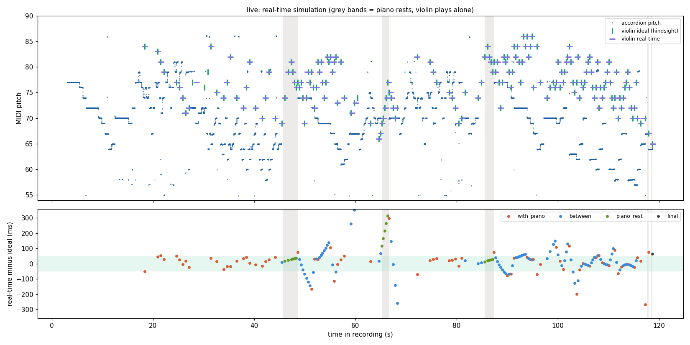

This is not a backing track. A backing track plays at a fixed speed, and you have to follow it. This program does the opposite: it follows you. You play the second violin part of the slow movement (Largo ma non tanto) of Bach’s Concerto for Two Violins, BWV 1043, measures 1–15. The program listens, works out where you are in the music, and plays the first violin with you. If you speed up, it speeds up; if you slow down, it slows down; if you stop, it waits for you.

A browser version you can try at home with your own instrument is in development. For now, this page has a demo recording, the score, and an explanation in two parts: Part 1 for players, Part 2 for readers interested in the theory behind it.

## Demo

<audio controls preload="none" src="/projects/adaptive-accompaniment/orchestra_mix.mp3"></audio>

String-ensemble version, measures 1–15. I play the second violin part on my accordion’s violin register, and the computer plays the other five parts. In a few places I deliberately slow down, speed up, or play wrong notes, so that you can hear the accompaniment adapt. It is not meant to be a polished performance.

## Part 1: For players

### What it does

- **It follows your pitch.** It listens to the pitch of each note you play and compares it with the score, the way you follow the notes on the page while someone else plays. Because it knows which note should come next, it only has to notice when that note begins.
- **The score is a map, not a clock.** The MIDI file tells the program where you are and which note comes next. The tempo written in the file does not matter; the real speed comes from your playing.
- **It plays its own part.** A harmonizer adds a voice that moves together with yours, the same melody shifted by an interval, so it can simply react to each note. This program plays a different part, with its own notes and rhythm, so it has one extra step: it predicts when your next note will come, so that its own notes arrive on time.
- **Two versions.** In the duet, the computer plays the first solo violin. In the string-ensemble version it also plays two more violins, a viola and a cello: six parts in all, including yours, one player on each part. All the parts share the same bars and beats, so once the program knows where you are, every instrument follows you together.
- **It knows a little about my style.** From my practice recordings it learned where I usually slow down or hurry, so it expects those places. Mostly, though, it simply listens and reacts.

### Before you play

- **Score:** [Download the duet score, full movement (PDF)](/projects/adaptive-accompaniment/score-duet-full.pdf). You play Violin II (marked as the Piano in the score). The project currently uses only measures 1–15, ending on the first beat of measure 16.
- **Tempo:** to hear how the piece sounds as a duet at a normal tempo, listen to this performance: [[BWV 1043 - Concerto for 2 Violins in D Minor (Largo) | Matteo Castellan, Accordions - YouTube](https://www.youtube.com/watch?v=D4fTYfmI4tE)]. Try to stay close to its average tempo: I trained the program at this speed, about 90% of the MIDI file’s tempo. Measures 1–15 take about two minutes, and the practice version covers only these measures.
- **Instrument:** it works best with one clear melody line, one note at a time, such as a violin register for an accordion’s treble side. Chords, or an accordion’s bass buttons, will confuse it. I set it up for my accordion, so another instrument may need a small adjustment.

### Setting up your devices

- **Recommended:** wired headphones; a headset with a microphone is fine. If your laptop has a built-in microphone, you don’t need a separate microphone; a desktop computer needs an external one.
- **Input and output:** choose the microphone as the input device, and wired headphones or the computer’s wired speakers or Bluetooth speaker as the output device.
- **Using a speaker:** place it away from the microphone, facing away from you, and keep the volume moderate. The microphone also hears the speaker, which can confuse the program. Every speaker behaves differently, so you may need to adjust the settings for your own.
- **Latency:** sound takes time to travel from the computer to the speaker. The page will show a latency setting you can adjust yourself. The default is 0.2 seconds, which suits Bluetooth speakers; with wired headphones or wired speakers, set it to 0.
- **Example, Sony SRS-XB40 (the Bluetooth speaker I tested):** about 75% volume works well, with latency at 0.2 seconds; above 80%, problems appear, which I am working on. Turn off EXTRA BASS, which is on by default: press the button once and its light goes off (holding it for 3 seconds turns off the speaker’s mood lights instead). Turn off ADD: if the L and R lights are on, hold the button for 3 seconds.

### While you play

- **If you stop, it waits.** Carry on from where you stopped; it cannot yet follow a jump to another place or a repeated passage.
- **Wrong notes:** one wrong note won’t throw it off, because it looks at the overall flow of the music. Many wrong notes in a row can make it lose its place for a moment.
- **After a rest** it may come in slightly late. Nobody, not even a computer, can know exactly when you will start again, so it waits for you, as a careful accompanist would.
- **In the string-ensemble version,** the strings join on the beat after your first note, because the program has to hear your first note to know when you started.

If you run into any problems, feel free to get in touch.

<!-- Add how to get in touch here (for example the comment section or an email address). -->

## Part 2: How it works

It reproduces, and adapts for live use, the model in Christopher Raphael’s paper “A Bayesian Network for Real-Time Musical Accompaniment” [1].

### Predict, don’t react

An accompanist cannot simply react, because reacting is always late; it has to predict the next note from what it has heard so far, as human musicians do. There are three ways to keep a second part in time with a player:

1. **Fixed clock:** play the MIDI file at a constant tempo.
2. **Line fitting** (my earlier MATLAB version): detect the player’s note onsets, fit a straight line to the recent ones, and extrapolate. This gives a single estimate with no measure of uncertainty.
3. **Bayesian filtering** (Raphael’s approach, used here): keep a probability distribution over where the player is and how fast they are playing, and predict the next note from it.

Raphael’s system has two modules, **Listen** and **Play**, plus a learning phase, **Learn**.

*One take: performance time against score time. The dashed line is a fixed MIDI clock; the scheduled violin notes follow the curve of the actual performance.*

### Listen: where is the player? (hidden Markov model)

The score of my part becomes a hidden Markov model [2, 4]. The hidden state $z_t$ is the note or rest I am on: 200 states (193 notes, 5 rests and 2 silences), chained from left to right. The observation $x_t$ is the pitch and voicing of each 10 ms frame of sound, measured with the YIN method [3].

From one frame to the next, the model can stay on a note, move to the next one, or, with a small probability (0.5%), step back. The probability of staying is set so that each note lasts, on average, its written length $d_j$ (in beats) at the current tempo $\hat s$ (in seconds per beat):

$$
p_j = 1 - \frac{\Delta t}{d_j\,\hat s}
$$

Every frame, the model predicts with one Markov step and then updates with the new frame using Bayes’ rule (the forward algorithm):

$$
p(z_t = j \mid x_{1:t}) \propto p(x_t \mid z_t = j) \sum_i A_{ij}\, p(z_{t-1} = i \mid x_{1:t-1})
$$

The likelihood compares the measured pitch $m_t$ with the written pitch $\mu_k$ of each note, with a tolerance of about a third of a semitone and a small floor, so that a single wrong frame cannot rule a note out:

$$
p(x_t \mid z_t = k) \propto 0.05 + 0.95 \exp\!\left(-\frac{(m_t - \mu_k)^2}{2\sigma^2}\right), \qquad \sigma = 0.35 \text{ semitone}
$$

Following the paper, a decision is delayed until it is confident: a note onset is declared only when the probability has moved to the next note and stayed there for two frames. In offline tests, 191 of the 193 notes were found.

*Offline alignment of one take. Blue: the accordion’s pitch in each frame. Orange: the notes of my part, as found by the model. Green: the first violin’s notes, re-timed to my performance. Below: my tempo in each measure relative to the MIDI file, about 0.85–0.9.*

### Play: when should the violin play? (Gaussian model and Kalman filter)

Play models time. For each note $n$, $t_n$ is its onset time, $s_n$ the local tempo (seconds per beat) and $l_n$ its written length:

$$
\begin{pmatrix} t_{n+1} \\ s_{n+1} \end{pmatrix}
= \begin{pmatrix} 1 & l_n \\ 0 & 1 \end{pmatrix}
\begin{pmatrix} t_n \\ s_n \end{pmatrix}
+ \begin{pmatrix} \tau_n \\ \sigma_n \end{pmatrix},
\qquad (\tau_n, \sigma_n)^\top \sim \mathcal{N}(\mu_n, \Sigma_n)
$$

Here $\tau_n$ stretches one note without changing the tempo, and $\sigma_n$ changes the tempo itself. The means $\mu_n$ describe the player’s habits, and the covariances $\Sigma_n$ how repeatable they are. The onset times reported by Listen are treated as the true times plus Gaussian noise. During the performance, the next accompaniment note is played at its conditional mean given everything observed so far, recomputed each time a new solo note is detected.

Because every variable is Gaussian and linked linearly, all of this can be computed exactly, without sampling. My version uses a single chain, on which this computation is the Kalman filter [5]:

$$
\begin{aligned}
\text{predict:}\quad & \hat{\mathbf{x}}^- = F\hat{\mathbf{x}}, \qquad P^- = F P F^\top + Q \\
\text{update:}\quad & K = P^- H^\top \left(H P^- H^\top + R\right)^{-1}, \quad \hat{\mathbf{x}} = \hat{\mathbf{x}}^- + K\left(y - H\hat{\mathbf{x}}^-\right), \quad P = (I - KH)P^-
\end{aligned}
$$

After a long gap, such as a rest, the prediction is uncertain, the gain $K$ is close to 1, and the filter trusts the new note; in a steady passage, the gain is small and the corrections are small.

### Learn: from rehearsals

In the paper, the means and covariances are learned from fewer than ten rehearsals with the EM algorithm. My version is simpler: it learns only the means, as each note’s median deviation from a steady tempo over seven recordings, shrunk halfway toward a steady tempo, with the amount chosen by cross-validation. It does not learn the covariances yet. Listen is calibrated on recordings, for the accordion’s tuning offset (about +17 cents) and the noise floor, rather than trained.

### What a live system needs

The paper does not discuss several things that turned out to be essential in live use:

1. **A pitch front end:** the YIN method [3], calibrated to my instrument.
2. **Stops and rests:** if I stop, the violin stops; after a rest, it waits for my entry instead of guessing.
3. **Gating:** an onset far earlier than predicted is treated as a wrong match; a late one, as a real slow-down.
4. **Smoothness:** the violin corrects 80% of its timing error per beat (a first-order autoregressive phase correction), and its intervals stay within 0.8–1.25 times the written length.
5. **Latency:** sound takes time to leave the computer, so each note is committed in advance. Over Bluetooth, about 0.12–0.2 seconds remained uncompensated.
6. **The loudspeaker:** the microphone also hears the program’s own violin, so each observation no longer depends only on the player’s note. Since the program knows exactly what it sent to the speaker, it ignores frames that match a sounding violin note, filters out its harmonics, and recognizes its echo after rests.

### Results

| Version                      | Mean absolute error | On notes shared with my part (75 of 179) |
| ---------------------------- | ------------------- | ---------------------------------------- |
| Fixed MIDI clock (per take)  | 1.8–6.4 s           | —                                        |
| Real time, means not learned | 109 ms              | 75 ms                                    |
| Real time, learned means     | 101 ms              | 70 ms                                    |

*Real-time rows: mean over three test takes that were never used during development. Reference: an offline, hindsight alignment of the same recording.*

*Real-time simulation of one take (duet). Top: the accordion’s pitch, the ideal violin notes in hindsight, and the notes scheduled in real time. Bottom: real-time minus ideal timing for each note. Grey bands: rests in my part, where the violin plays alone.*

Most of the remaining error comes from the rests: around them my tempo varies by 4–7.5% between takes, compared with about 1% elsewhere. That variation is random, so learning the means cannot remove it. In the paper’s model this is exactly what the covariances capture, which makes learning them the clearest next step.

### References

1. C. Raphael. A Bayesian network for real-time musical accompaniment. *Advances in Neural Information Processing Systems* 14, 2001.
2. C. Raphael. Automatic segmentation of acoustic musical signals using hidden Markov models. *IEEE Transactions on Pattern Analysis and Machine Intelligence* 21(4), 1999.
3. A. de Cheveigné and H. Kawahara. YIN, a fundamental frequency estimator for speech and music. *Journal of the Acoustical Society of America* 111(4), 2002.
4. L. R. Rabiner. A tutorial on hidden Markov models and selected applications in speech recognition. *Proceedings of the IEEE* 77(2), 1989.
5. C. M. Bishop. *Pattern Recognition and Machine Learning*, Chapter 13. Springer, 2006.
