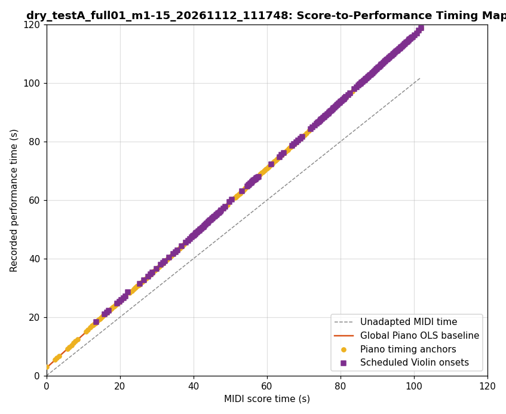
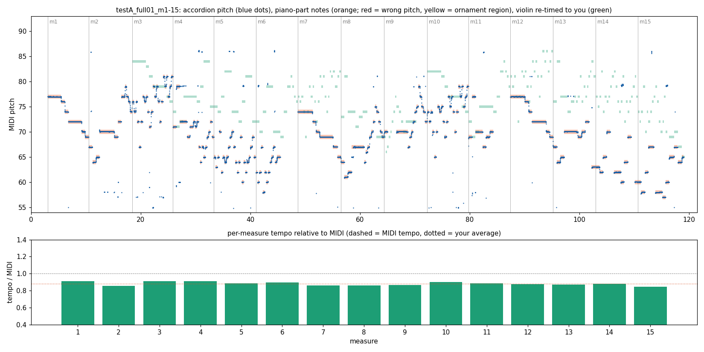
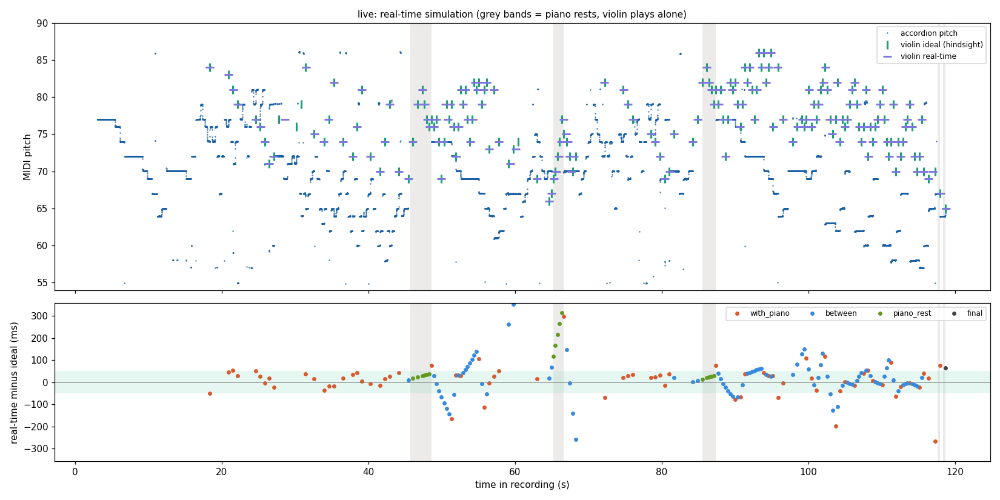

这不是伴奏带。伴奏带以固定的速度播放，演奏的人得跟着它走；这个程序正好相反，它跟着你走。你演奏巴赫《双小提琴协奏曲》（BWV 1043）慢乐章（Largo ma non tanto）第 1–15 小节的第二小提琴声部，程序一边听，一边判断你演奏到了乐谱的哪个位置，同时为你演奏第一小提琴。你加快，它就加快；你放慢，它就放慢；你停下来，它就等你。

可以在家用自己的乐器试用的网页版正在开发中。目前这个页面有一段演示录音、乐谱，以及分成两部分的介绍：第一部分写给演奏者，第二部分写给对背后的理论感兴趣的读者。

## 演示

<audio controls preload="none" src="/projects/adaptive-accompaniment/orchestra_mix.mp3"></audio>

弦乐合奏版，第 1–15 小节。我用手风琴的小提琴音色演奏第二小提琴声部，其余五个声部由电脑演奏。录音中有几处我故意放慢、加快或者弹错，好让大家听到伴奏是怎样随之调整的。这并不是一段追求完美的演奏。

## 第一部分：写给演奏者

### 它在做什么

- **它跟随你的音高。** 程序听你演奏的每个音的音高，并和乐谱对照，就像别人演奏时你看着谱子跟上一样。因为它知道下一个应该是哪个音，所以只需要留意这个音什么时候开始。
- **乐谱是地图，不是时钟。** MIDI 文件告诉程序你在哪里、下一个音是什么。文件里写的速度并不重要，真正的速度来自你的演奏。
- **它演奏自己的声部。** 和声器（harmonizer）添加的是一个和你同步移动的声部，也就是把同一条旋律移高或移低一个音程，所以它只要对你的每个音做出反应就行。这个程序演奏的是另一个声部，有自己的音和节奏，所以多了一步：它要预测你的下一个音什么时候出现，好让自己的音准时响起。
- **两个版本。** 二重奏版中，电脑演奏第一独奏小提琴。弦乐合奏版中，电脑还演奏另外两把小提琴、一把中提琴和一把大提琴：连同你的声部一共六个声部，每个声部一人。所有声部都写在同样的小节和拍子上，所以只要程序知道你在哪里，所有乐器就会一起跟随你。
- **它对我的演奏习惯略知一二。** 程序从我的练习录音中学到了我通常在哪里放慢、在哪里赶，所以会对这些地方有所预期。但大部分时候，它只是在听，并随之反应。

### 演奏之前

- **乐谱：** [下载二重奏总谱，完整乐章（PDF）](/projects/adaptive-accompaniment/score-duet-full.pdf))。你演奏的是 Violin II（标记为Piano的部分）。这个项目目前只用到第 1–15 小节，到第 16 小节第一拍结束。
- **速度：** 想知道这首曲子用二重奏、以正常速度演奏是什么样子，可以听这段演奏：[[BWV 1043 - Concerto for 2 Violins in D Minor (Largo) | Matteo Castellan, Accordions - YouTube](https://www.youtube.com/watch?v=D4fTYfmI4tE)]。演奏时尽量接近它的平均速度：我训练程序时就是以这个速度为标准，大约是 MIDI 文件速度的 90%。第 1–15 小节大约两分钟，练习版只包含这一部分。
- **乐器：** 最适合一次只奏一个音的清晰旋律，比如小提琴register手风琴的右手部分。和弦或者手风琴的贝斯键会让它困惑。我是按自己的手风琴设置的，换成别的乐器可能需要稍作调整。

### 设置你的设备

- **推荐：** 戴有线耳机，带麦克风的耳机也可以。如果笔记本电脑自带麦克风，就不需要额外接麦克风；台式电脑则需要外接一个。
- **输入和输出：** 输入设备选麦克风，输出设备选有线耳机或电脑的有线音箱或蓝牙音箱。
- **用音箱外放时：** 把音箱放在离麦克风远一点的地方，背对演奏者，音量不要太大。麦克风也会收到音箱的声音，可能干扰程序。不同音箱的情况不一样，需要针对自己的音箱调整设置。
- **延迟（latency）：** 声音从电脑传到音箱需要时间。网页上会显示一个延迟设置，可以自己调节。默认值是 0.2 秒，适合蓝牙音箱；如果用有线耳机或有线音箱，请调成 0。
- **以我测试过的蓝牙音箱 SONY SRS-XB40 为例：** 音量在 75% 左右效果比较好（延迟 0.2 秒）；超过 80% 会出现一些问题，我正在改进。关掉 EXTRA BASS 模式：它默认是打开的，按一下按钮，灯灭就是关掉了（按住 3 秒关闭的是音箱的氛围灯）。关掉 ADD 功能：如果 L 和 R 的灯亮着，按住 3 秒关闭。

### 演奏时

- **你停下来，它就等你。** 停下后请从停下的地方接着演奏；它目前还不能跟随你跳到别的地方，或者重复某一段。
- **弹错音：** 弹错一个音不会让它乱，因为它看的是音乐的整体走向。但连续弹错很多个音，它可能会暂时找不到位置。
- **休止之后**，它进来时可能会稍晚一点。没有人能准确知道你什么时候重新开始，电脑也不能，所以它会等你，就像一位谨慎的伴奏者那样。
- **在弦乐合奏版中**，弦乐会在你第一个音之后的那一拍进入，因为程序要听到你的第一个音，才知道你从什么时候开始。

如果遇到什么问题，欢迎联系我。

<!-- 在这里补上联系方式（例如留言区或邮箱地址）。 -->

## 第二部分：原理

它复现了 Christopher Raphael 的论文《A Bayesian Network for Real-Time Musical Accompaniment》[1] 中的模型，并针对现场演奏做了调整。

### 预测，而不是反应

伴奏者不能只是被动地反应，因为反应总是会迟；它必须根据已经听到的内容预测下一个音，就像人类音乐家那样。让第二个声部和演奏者保持同步，有三种做法：

1. **固定时钟：** 按固定速度播放 MIDI 文件。
2. **直线拟合**（我之前的 MATLAB 版本）：检测演奏者的起音，对最近的几个起音拟合一条直线，再外推。这样得到的只是一个估计值，不包含任何不确定性。
3. **贝叶斯滤波**（Raphael 的方法，也是这里采用的）：对演奏者的位置和速度保持一个概率分布，并据此预测下一个音。

Raphael 的系统由两个模块组成，**聆听（Listen）**和**演奏（Play）**，另外还有一个学习阶段，**学习（Learn）**。

*一次录音：演奏时间与乐谱时间的对应关系。虚线是固定的 MIDI 时钟；程序安排的小提琴音符跟着实际演奏的曲线走。*

### 聆听：演奏者在哪里？（隐马尔可夫模型）

我演奏的声部被建成一个隐马尔可夫模型 [2, 4]。隐藏状态 $z_t$ 是我正在演奏的音符或休止：一共 200 个状态（193 个音符、5 个休止、2 段静音），从左到右连成一条链。观测 $x_t$ 是每 10 毫秒一帧声音的音高和是否有声，用 YIN 方法测量 [3]。

从一帧到下一帧，模型可以停留在当前音符、移到下一个音符，或者以很小的概率（0.5%）退回一步。停留的概率经过设定，使每个音符平均持续的时间，等于它在当前速度 $\hat s$（秒/拍）下的记谱时值 $d_j$（拍）：

$$
p_j = 1 - \frac{\Delta t}{d_j\,\hat s}
$$

每一帧，模型先用一步马尔可夫转移做预测，再用新的一帧按贝叶斯公式更新（前向算法）：

$$
p(z_t = j \mid x_{1:t}) \propto p(x_t \mid z_t = j) \sum_i A_{ij}\, p(z_{t-1} = i \mid x_{1:t-1})
$$

似然把测到的音高 $m_t$ 和每个音符的记谱音高 $\mu_k$ 作比较，容差大约三分之一个半音，并设一个很小的下限，这样单独一帧的错音不会把一个音符完全排除：

$$
p(x_t \mid z_t = k) \propto 0.05 + 0.95 \exp\!\left(-\frac{(m_t - \mu_k)^2}{2\sigma^2}\right), \qquad \sigma = 0.35 \text{ 个半音}
$$

和论文一样，判断要等到有把握时才做出：只有当概率移到下一个音符并在那里停留两帧，才确认这是一个起音。在离线测试中，193 个音符找到了 191 个。

*一次录音的离线对齐。蓝色：每一帧手风琴的音高。橙色：模型找到的我这个声部的音符。绿色：按我的演奏重新排定时间的第一小提琴音符。下图：我在每个小节的速度相对于 MIDI 文件的比例，大约 0.85–0.9。*

### 演奏：小提琴什么时候该响？（高斯模型与卡尔曼滤波）

演奏模块为时间建模。对每个音符 $n$，$t_n$ 是它的起音时间，$s_n$ 是局部速度（秒/拍），$l_n$ 是它的记谱时值：

$$
\begin{pmatrix} t_{n+1} \\ s_{n+1} \end{pmatrix}
= \begin{pmatrix} 1 & l_n \\ 0 & 1 \end{pmatrix}
\begin{pmatrix} t_n \\ s_n \end{pmatrix}
+ \begin{pmatrix} \tau_n \\ \sigma_n \end{pmatrix},
\qquad (\tau_n, \sigma_n)^\top \sim \mathcal{N}(\mu_n, \Sigma_n)
$$

其中 $\tau_n$ 在不改变速度的情况下拉长某一个音，$\sigma_n$ 则改变速度本身。均值 $\mu_n$ 描述演奏者的习惯，协方差 $\Sigma_n$ 描述这些习惯有多稳定。聆听模块报告的起音时间，被视为真实时间加上高斯噪声。演奏过程中，下一个伴奏音在给定目前所有观测时的条件均值处响起；每检测到一个新的独奏音，就重新计算一次。

因为所有变量都服从高斯分布，并且彼此线性相关，这些计算都可以精确完成，不需要采样。我的版本只用一条链，在链上，这种计算就是卡尔曼滤波 [5]：

$$
\begin{aligned}
\text{预测：}\quad & \hat{\mathbf{x}}^- = F\hat{\mathbf{x}}, \qquad P^- = F P F^\top + Q \\
\text{更新：}\quad & K = P^- H^\top \left(H P^- H^\top + R\right)^{-1}, \quad \hat{\mathbf{x}} = \hat{\mathbf{x}}^- + K\left(y - H\hat{\mathbf{x}}^-\right), \quad P = (I - KH)P^-
\end{aligned}
$$

经过一段较长的间隔（比如休止）之后，预测很不确定，增益 $K$ 接近 1，滤波器会相信新的音；在平稳的段落里，增益很小，修正也很小。

### 学习：从排练中学

在论文里，均值和协方差是用 EM 算法从不到十次排练中学到的。我的版本更简单：只学均值，也就是每个音符在七次录音中相对于匀速的偏差的中位数，再向匀速收缩一半，收缩的程度用交叉验证选定。协方差目前还没有学。聆听模块则是在录音上校准的（手风琴的音准偏差约 +17 音分，以及底噪），而不是训练出来的。

### 现场演奏还需要什么

有几件事论文没有讨论，但在现场使用中证明是必不可少的：

1. **音高前端：** 用 YIN 方法 [3]，并针对我的乐器做了校准。
2. **停顿和休止：** 我停下来，小提琴也停下来；休止之后，它会等我进入，而不是去猜。
3. **门限：** 比预测早很多的起音被当作错误的匹配；晚到的起音则被当作真正的放慢。
4. **平滑：** 小提琴每拍只修正 80% 的时间误差（一阶自回归相位校正），音与音的间隔保持在记谱时值的 0.8–1.25 倍之间。
5. **延迟：** 声音离开电脑需要时间，所以每个音都要提前确定。通过蓝牙播放时，大约还有 0.12–0.2 秒没有得到补偿。
6. **音箱：** 麦克风也会收到程序自己的小提琴声，于是每个观测不再只取决于演奏者的音。因为程序确切知道自己向音箱发送了什么，它会忽略和正在发声的小提琴音相符的帧，滤掉它的泛音，并在休止之后识别出它的回声。

### 结果

| 版本               | 平均绝对误差    | 与我的声部同时发声的音符（179 个中的 75 个） |
| ---------------- | --------- | -------------------------- |
| 固定 MIDI 时钟（每次录音） | 1.8–6.4 秒 | —                          |
| 实时，不学习均值         | 109 毫秒    | 75 毫秒                      |
| 实时，学习均值          | 101 毫秒    | 70 毫秒                      |

*实时两行：三次在开发过程中从未使用过的测试录音的平均值。参照：对同一段录音所做的离线（事后）对齐。*

*一次录音的实时模拟（二重奏）。上图：手风琴的音高、事后确定的理想小提琴音符，以及实时安排的音符。下图：每个音符的实时时间与理想时间之差。灰色区域：我的声部休止、小提琴单独演奏的地方。*

剩下的误差大部分来自休止附近：那里我的速度在不同录音之间相差 4–7.5%，而其他地方只相差约 1%。这种差异是随机的，学习均值无法消除它。在论文的模型中，这正是协方差所刻画的东西，所以学习协方差是最明确的下一步。

### 参考文献

1. C. Raphael. A Bayesian network for real-time musical accompaniment. *Advances in Neural Information Processing Systems* 14, 2001.
2. C. Raphael. Automatic segmentation of acoustic musical signals using hidden Markov models. *IEEE Transactions on Pattern Analysis and Machine Intelligence* 21(4), 1999.
3. A. de Cheveigné and H. Kawahara. YIN, a fundamental frequency estimator for speech and music. *Journal of the Acoustical Society of America* 111(4), 2002.
4. L. R. Rabiner. A tutorial on hidden Markov models and selected applications in speech recognition. *Proceedings of the IEEE* 77(2), 1989.
5. C. M. Bishop. *Pattern Recognition and Machine Learning*, Chapter 13. Springer, 2006.
