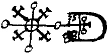
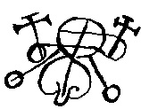
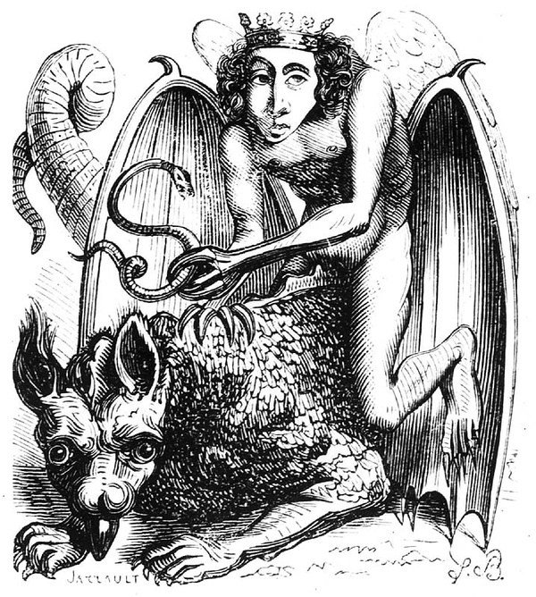
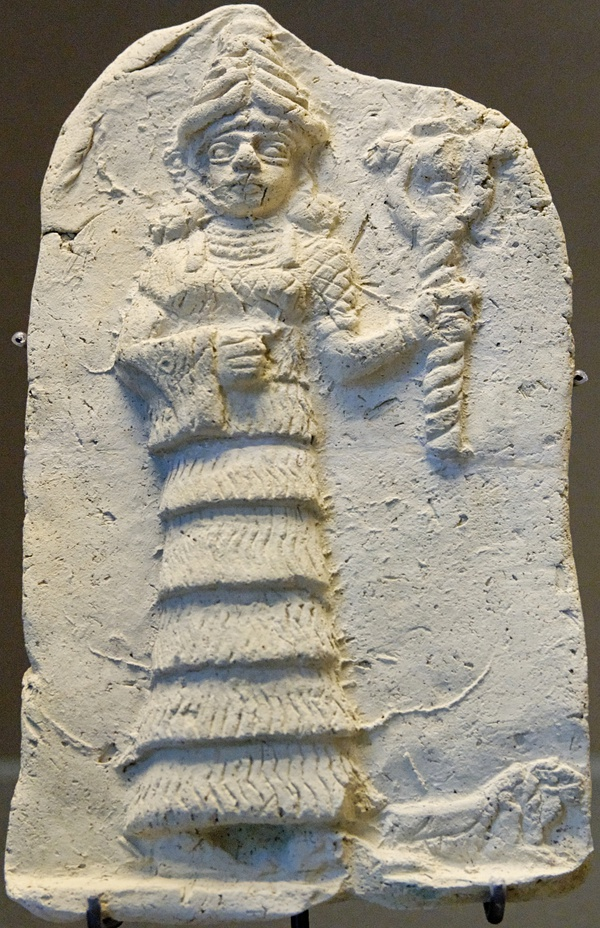
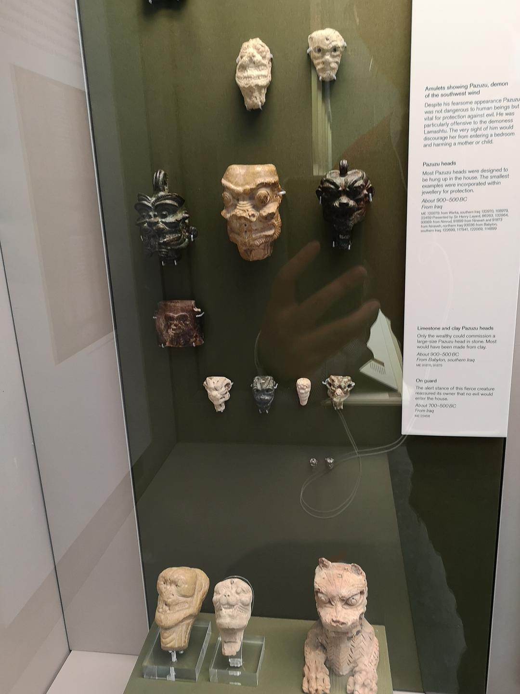

While the Warcraft film met with fire in China and ice in the US, James Wan’s *The Conjuring 2* scared American audiences out of their wits, and still they kept streaming in to see it: knocks at the door, lights suddenly going out, screams, brown eyes… I suspect Honest Trailers has found its next target. Here is some background on the demon of the sequel.

Whereas Bathsheba, the demon who held the stage in the first *Conjuring*, came merely from an early-20th-century country witch, the demon Valac in the sequel (pronounced the same as Valak) is a demon with quite a history. Valac comes from *The Lesser Key of Solomon*, a 17th-century work of demonology written in Latin by an unknown author. It lists 72 demons by name along with their corresponding seals, and among them is Valac, the demon who appears in this film.

According to the description in the English translation of the book:

The 62d spirit is called Valac, he is a mighty great president & appeareth like a Boy wth angels wings, ridding on a 2 headed Dragon; his office is to give True answares of hidden Treasures, and to tell where serpents may be seene, wch he will bring & dilever ［deliver, discover］ to ye Exorcist without any force or strengeth, he governeth 30 Legions of spirits, his seal is This wch must be made & worne as a Lamin &c. (The original can be found at link 3 at the end of this post.)

*The seal of Valac, 62nd of the 72*

Because Baidu Baike’s account of several concepts related to the original work is rather muddled, let me make a special point of clarifying them. This work, called *The Lesser Key of Solomon* (the lesser key of Solomon), was originally known as the Lemegeton, or by its Latin name Clavicula Salomonis. The first of its five parts, the Ars Goetia, introduces the 72 demons and their corresponding seals and magic circles. There is an earlier work with a similar name, *The Key of Solomon* (key of Solomons, or in Latin Clavis Salomonis; after all, both Clavis and Clavicula mean “key”), whose content and line of transmission have no clear connection to it. *The Key of Solomon* appeared in Italy in the 14th or 15th century and likewise describes how to set up magic circles and perform various rituals of summoning. Some speculate that *The Key of Solomon* inspired the later creation of *The Lesser Key of Solomon*, or that the two share earlier reference materials that can be traced back. These materials, together with biblical culture, then evolved into modern black magic, demonology, and so on.

True, the openings of both films carry the gimmick “based on real story,” but if you dig into the sources a little, you will find some interesting things.

First, whether it is *The Key of Solomon*, which came first, or *The Lesser Key of Solomon*, which came later, neither is a primary source. Both are claimed to be magical scrolls discovered by Solomon, the Jewish king recorded in the Bible. Lost for a thousand years and then suddenly reappearing, even if these manuscripts really existed, their incompleteness and obscurity prevented them from being effectively interpreted and passed on. Someone compared them to a medieval *Quantum Mechanics*.

Second, translating these materials written in ancient Hebrew also became a great nuisance, and that is not even counting the various versions arising from different translators’ different understandings. When they were translated into Latin, Italian, and French, these second-hand versions repeated the problems of the earlier translations, and then they were turned into English on entering the 20th century. You can imagine how accurate their content is.

Besides, why is everything we hear about exorcism always inseparable from religion? And why do so many cases point directly to God? What, then, should other religions, such as Islam and Buddhism, and the vast number of atheists make of this unequal treatment? Do demons have to change their clothes before they can enter the lives of people of other faiths?

On where demons’ names come from, here are two more examples:

Among Solomon’s 72 demons, the first-ranked king Bael takes his name from a god of fertility of ancient Phoenicia (in present-day Syria) around 1300 BC, also known as Prince Baal (Baal-zebul). Worship of this fertility god there lasted nearly two thousand years, and the local people believed that Baal brought rain in winter and hid underground to escape the heat in summer (a Mediterranean climate). Later, when Bael passed into the records of Judaism, he was changed into Beelzebub and demonized as a demon who brings disease and disaster, the “[Lord of the Flies](http://www.esotericarchives.com/psellos/daemonibus.pdf).” These ideas were carried on in the Bible, where [Beelzebub is sometimes regarded as Satan himself](http://jewishencyclopedia.com/articles/13219-satan), or as [a demon second only to Satan](https://en.wikipedia.org/wiki/Beelzebub).

*The seal of Bael*

Another, ranked 29th, is the duke Astaroth (also called Astarot, Ashtaroth, Asteroth). In the descriptions of the 72 demons, he is depicted as a male angel holding a viper in one hand and riding an infernal dragon. He has the power to travel through time and can teach all the sciences, and every August is when his power against humanity is at its strongest. In the early centuries AD, Asteraoth was the image of an angel opposing demons in Greek, while in Phoenician before the Common Era the name referred to the goddess Astarte, who can in turn be traced back to Ishtar, the Babylonian goddess of love, fertility, and war, and further back still to Inanna, the goddess of fertility and war in Sumerian culture.

*Astaroth illustration (1818)*

*Ishtar holding her symbol*

If sowing salt on Carthage’s land after the Roman conquest was merely a ritual, then later generations erasing it from their ideas and reinterpreting it is far more frightening.

Two more things about demons are worth mentioning. Humanity only began systematically exploring geological structures such as the distribution of magma and the Earth’s crust in the early 20th century, yet the Bible’s description of the demons’ homeland, hell, as an underground place full of fire came much, much earlier. The same is true of Islam, and although the Buddhist concept of hell is more abstract, it also speaks of the “Eight Hot Hells.” Perhaps in myths, legends, and religious beliefs there are also some facts not yet revealed.

The other point, coming back to horror films like *The Conjuring* that center on demonic spirits causing trouble: do they not also make us think about what death really means? How do we regard the parts of the world that cannot be known, and accept the bounded rationality of groups and individuals?

PS:

The touches of tenderness that show through now and then in *The Conjuring* 1 and 2 reminded me of [an episode the Discovery Channel made more than ten years ago (the last episode at the link)](http://www.bilibili.com/video/av2705127/index_5.html), which discussed the concept of the demon in a neutral way, including the perspective of Western exorcism, psychological explanations, and origins in ancient civilizations. Not reducing reality to simple, clear-cut binaries puts it far above the film in conception.

<http://www.bilibili.com/video/av2705127/index_5.html>

Further reading:

<https://en.wikipedia.org/wiki/Key_of_Solomon> English Wikipedia: Key of Solomon

<https://en.wikipedia.org/wiki/Lesser_Key_of_Solomon#cite_note-1> English Wikipedia: Lesser Key of Solomon

<http://www.esotericarchives.com/solomon/goetia.htm> *The Lesser Key of Solomon* in English, Part 1

<http://www.esotericarchives.com/solomon/ksol.htm> *The Key of Solomon* in English, full text

<https://www.douban.com/group/topic/56346800/> A Douban discussion of Solomon’s magic circles

<https://movie.douban.com/review/7935304/> A Douban film review with photos of Valak

<http://www.newadvent.org/cathen/> Catholic Encyclopedia

<http://jewishencyclopedia.com/> Jewish Encyclopedia

<https://en.wikipedia.org/wiki/Beelzebub> English Wikipedia: Beelzebub

<http://www.99lib.net/book/308/12259.htm> *The Golden Bough* (J. G. Frazer), Chapter 18: The Perils of the Soul, Section 2: Absence and Recall of the Soul

Afterword:

Two years later, last month I watched a short TV documentary (The Devil and Father Amorth) by William Friedkin, director of the 1973 film *The Exorcist*, and only then learned that the exorcist priest interviewed by the Discovery Channel in the PS link above, Father Amorth of Italy, had passed away.

In the debate over evil spirits and possession, a good deal of research in the medical field links it to dissociate trance disorder (DID, dissociative identity disorder, or a type of multiple personality), including comparative studies of possession cases from different religious backgrounds. Here are four fairly representative ones I found; viewers still shaken after the film can look them up to calm their nerves.

A Critical Review of Dissociative Trance and Possession Disorders (Emmanuel, Fanny et al.) The Canadian Journal of Psychiatry 2011 Vol56,No.4

Dissociative disorders and possession experiences in Israel: A comparison of opiate use disorder patients, Arab women subjected to domestic violence,and a nonclinical group (Somer, Ross et al.) Transcultural Psychiatry 2014

Dissociative trance disorder: clinical and Rorschach findings in ten persons reporting demon possession and treated by exorcism (Ferracuti , Sacco, Lazzari) Journal of Personality Assesment 1996

GANGGUAN KESURUPAN DAN TERAPI RUQYAH (Zainul Arifin dan Zulkhair)

It is a pity that the cases in DID research do not include rare cases such as memories of past lives or the transfer of a dead person’s memories, and such cases are also the hardest to explain with DID. One thing I can say with great certainty here is that beyond the world that keeps pace with what we see and hear every day, there is another world we are unfamiliar with and do not understand, where there exist all kinds of things that answer people’s everyday fantasies, magnificent and dark.

*pazuzu*
