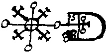
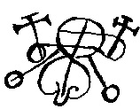
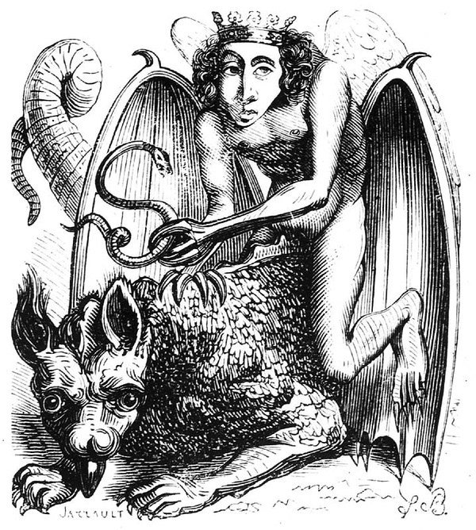
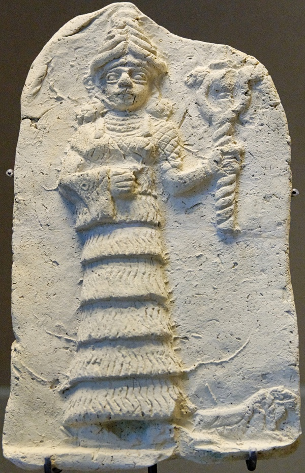
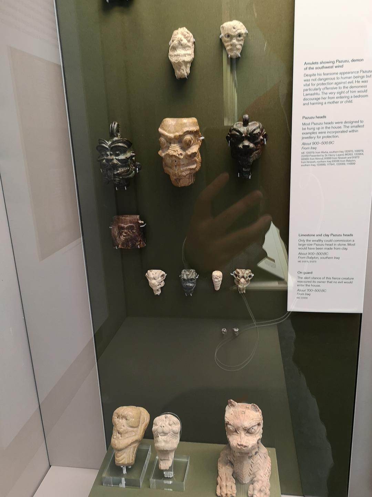

魔兽电影在中美上映冰火两重天的同期，温子仁的《招魂2》把美国观众吓得屁滚尿流仍然络绎不绝前去观看，敲门声、忽然灭灯、尖叫、褐色双瞳……相信诚实预告片又有了新的吐槽对象。这里介绍一些关于2代恶魔的背景资料。

相比招魂1中压场恶魔Bathsheba只是源自一个20世纪早期的乡村女巫，2代里的恶魔Valac(与Valak同音)却是一个颇有历史的恶魔。Valac出自一本十七世纪用拉丁语写成的恶魔学著作《所罗门的小钥匙》，作者不详，其中指名道姓地列举了72位恶魔及其对应封印符，其中便有本片中出现的恶魔Valac。

根据这本书翻译成英文之后的介绍，Valac外表上是有一对天使翅膀，并且骑着一只双头龙的少年，其能力是能够明确答复出宝藏的位置，告诉人们哪里会有大蛇（或毒蛇），并且不需要花费任何能量便可以传送到驱魔人那里。Valac还是一位伟大的统领，手下有30支恶魔军团。

The 62d spirit is called Valac, he is a mighty great president & appeareth like a Boy wth angels wings, ridding on a 2 headed Dragon; his office is to give True answares of hidden Treasures, and to tell where serpents may be seene, wch he will bring & dilever ［deliver, discover］ to ye Exorcist without any force or strengeth, he governeth 30 Legions of spirits, his seal is This wch must be made & worne as a Lamin &c.（原文可在文末链接3中查看）

*位列72位中第62位的Valac的封印符*

因为百度百科上关于原著的几个概念之间表述比较混乱，因此特别阐明一下，这本叫《所罗门的小钥匙》（the lesser key of Solomon ）的著作，原本被称作Lemegeton，或者拉丁语的原名Clavicula Salomonis，它的五部分内容中第一部分Ars Goetia便是关于72位恶魔的介绍及对应封印符魔法阵。它有一个名字相似但内容和著作传承都缺乏明确关联的早期作品《所罗门的钥匙》（key of Solomons，或者拉丁语Clavis Salomonis，毕竟Clavis与Clavicula都是钥匙的意思），《所罗门的钥匙》出现在14、15世纪的意大利，也是关于设立魔法阵及各种召唤仪式的介绍。有推测认为《所罗门的钥匙》激发了后来《所罗门的小钥匙》的创作灵感，又或者二者之间有共通的早期参考资料可以追溯，这些材料与圣经文化又演变出了当代的黑魔法、恶魔学等等。

固然1/2部影片开头都加上了based on real story这样的噱头，如果仔细发掘一下来源，会有一些有意思的发现。

首先，按照时间无论是先出现的《所罗门的钥匙》还是后出现的《所罗门的小钥匙》，都并非一手资料，而是被宣称为圣经里记载的犹太国王所罗门所发现的魔法遗卷。失传千年突然重现，即便真有那些手稿，内容不全而且难以理解便阻止了有效解读和传递，有人打比方说这是中世纪的《量子力学》。

其次，翻译这些古希伯来文写成的材料也成了很麻烦的事，这还不包括基于不同翻译者的不同理解的各种版本，当它们被翻译成拉丁语、意大利语、法语之后这些二手货再次重复了之前翻译的问题，再转成英语进入20世纪，可想而知其内容的准确性。

另外，为何我们听到的驱魔相关内容总是与宗教密不可分？而很多案例都直指上帝？那么其他宗教，比如伊斯兰教、佛教，以及广大无神论者又该如何对待这样的差别对待呢？是不是恶魔得给自己换一身衣服才能够进入其他不同信仰人群的生活中呢？

关于恶魔名称的来源，再举两个例子：

在所罗门72魔神中，位列首位的魔王巴尔（Bael），其名字源自公元前1300年古国腓尼基（位于如今叙利亚境内）的丰饶之神，又名巴尔王子（Baal-zebul），当地对这位丰饶之神的崇拜持续了近两千年，并且当地人认为是巴尔在冬季带来降雨，在夏季则躲入地下避暑（地中海气候）。后来巴尔（Bael）传递到犹太教的记载中便被改为了别西卜（Beelzebub），被妖魔化为带来疾病和灾害的恶魔“苍蝇王”（[Lord of the Flies](http://www.esotericarchives.com/psellos/daemonibus.pdf)），这些内容在圣经里得到了传承，有时[别西卜也被视为了撒旦本人](http://jewishencyclopedia.com/articles/13219-satan)，或者[地位仅次于撒旦的魔神](https://en.wikipedia.org/wiki/Beelzebub)。

*巴尔（Bael）的封印符*

另一位排行29位的是公爵亚斯他录（阿斯塔路，亚世他，Astaroth，又名Astarot、Ashtaroth,  Asteroth），在72魔神的介绍中被描述为一手持着毒蛇，骑在地狱龙身上的男性天使形象，拥有穿越时间的能力，并且可教人知晓所有科学知识，而每年八月，是其对抗人类的力量最强的时候。在公元纪年的早期，Asteraoth在希腊语中是对抗恶魔的天使形象，而在公元前在腓尼基语中是指代女神雅诗塔特（goddess Astarte），这又可以追溯到巴比伦王朝的爱情、生育、战争女神伊什塔（Ishtar），以及更早的苏美尔文化中的生育和战争女神伊南娜（Inanna）。

*Astaroth illustration （1818）*

*Ishtar holding her symbol*

如果罗马征服迦太基之后在其土地上撒盐只是一种仪式，后世从观念上予以抹杀并重新诠释更为可怕。

关于恶魔还有两件事情值得一提，人类系统性地探索包括熔岩分布、地壳这些地理结构是在20世纪初才进行，而圣经中关于恶魔的故乡——地狱的描述，充斥着火的地下，则要早很多很多，伊斯兰教亦然，而佛教中关于地狱的概念固然更为抽象，也有“八炎火地狱”一说。神话传说宗教信仰里，或许也有一些尚未点破的事实。

另外一点，回到招魂这类以恶魔灵魂作祟为题材的恐怖片，是否也会让人去思考，死亡到底意味着什么？我们如何看世界上一些不可认知的那部分并承认群体和个体的有限理性？

PS：

《招魂1/2》中不时透露出的丝丝温情，让我想起十多年前探索频道做过的[一期节目（链接中的最后一集）](http://www.bilibili.com/video/av2705127/index_5.html)，中性地探讨了恶魔（demon）概念，其中包括了西方驱魔的视角，心理学层面的解释，以及古代文明的溯源。不把现实归结于简单明了的二元对立概念，从立意上说，远远高于电影。

<http://www.bilibili.com/video/av2705127/index_5.html>

拓展阅读：

<https://en.wikipedia.org/wiki/Key_of_Solomon> 所罗门钥匙维基英文

<https://en.wikipedia.org/wiki/Lesser_Key_of_Solomon#cite_note-1> 所罗门小钥匙维基英文

<http://www.esotericarchives.com/solomon/goetia.htm> 所罗门的小钥匙英文第一部分

<http://www.esotericarchives.com/solomon/ksol.htm> 所罗门的钥匙英文全文

<https://www.douban.com/group/topic/56346800/> 所罗门魔法阵的豆瓣讨论

<https://movie.douban.com/review/7935304/> 带有valak照片的豆瓣影评

<http://www.newadvent.org/cathen/> 天主教百科

<http://jewishencyclopedia.com/> 犹太教百科

<https://en.wikipedia.org/wiki/Beelzebub> 别西卜维基英文

<http://www.99lib.net/book/308/12259.htm>《金枝》（J.G.弗雷泽）第十八章： 灵魂的危险    第二节：灵魂离体与招魂

后记：

时隔2年，上个月看73年驱魔人电影导演 威廉•弗莱德金的一部电视纪录短片（The Devil and Father Amorth）才得知，上文PS链接中探索频道采访的驱魔神父，意大利的Father Amorth已经去世。

关于恶灵、附身的争论，医学界有不少研究将此认为与dissociate trance disorder（DID分离性身份识别障碍，或多重人格的一种类型）有关，其中不乏从不同宗教背景的附身案例的比较研究，这里找到4篇比较有代表性的，看完电影惊魂未定的观众可以去找来读一下压压惊。

A Critical Review of Dissociative Trance and Possession Disorders (Emmanuel,Fanny等) The Canadian Journal of Psychiatry 2011 Vol56,No.4

Dissociative disorders and possession experiences in Israel: A comparison of opiate use disorder patients, Arab women subjected to domestic violence,and a nonclinical group（Somer,Ross等）   Transcultural Psychiatry 2014

Dissociative trance disorder: clinical and Rorschach findings in ten persons reporting demon possession and treated by exorcism (Ferracuti , Sacco, Lazzari) Journal of Personality Assesment 1996

GANGGUAN KESURUPAN DAN TERAPI RUQYAH (Zainul Arifin dan Zulkhair)

有些可惜的是，DID研究的案例并未涉及诸如前世回忆或者逝者记忆转嫁的稀少案例，而这样的案例也是最难以用DID去解释的。在此笔者可以十分确定的一件事是，与我们日常见闻同步的世界之外，还有一个我们不熟悉也不了解的世界，那里存在着各种满足人们日常幻想的事物，瑰丽而黑暗。

*pazuzu*
